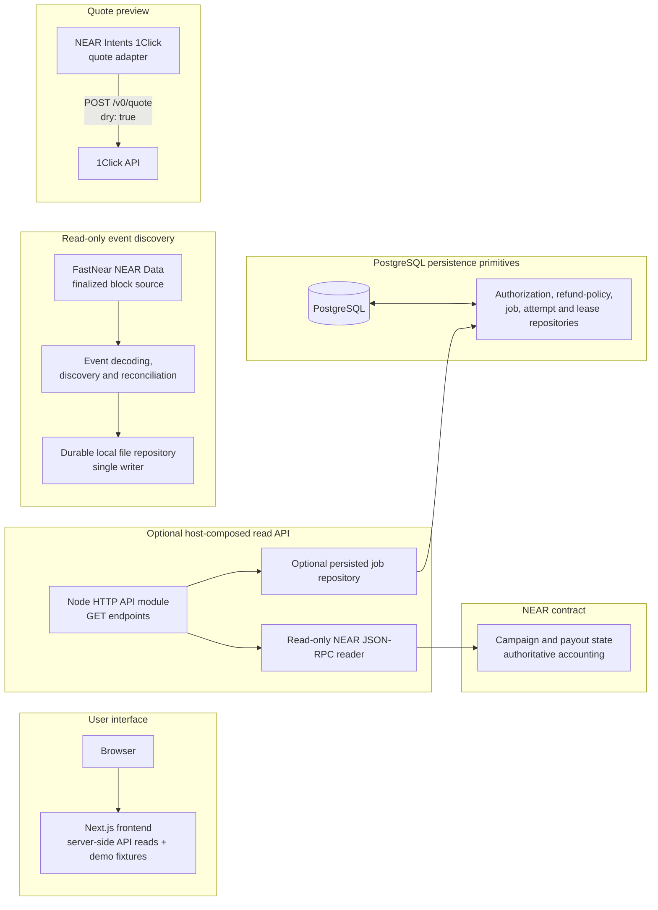

# Disburse

**One campaign. Multiple recipients. Multiple blockchain networks. One coordinated payout experience.**

Disburse is a cross-chain payout coordination project. It is designed to help platforms organize
campaign budgets and payouts when recipients use different blockchain networks. Its intended use
cases include payroll, creator payments, grants, DAO distributions, and other platform payouts.
These are potential use cases, not claims that live payment workflows are available today.

> **Current status: development foundation, not production payment software.** The repository
> contains a NEAR contract, a Next.js frontend with an optional server-side read-API connection,
> and a TypeScript execution-service foundation. Demo campaigns, recipients, and forms remain
> illustrative. There is no
> production worker, transaction signer, live payout submission, independent destination-chain
> verifier, or complete quote-to-settlement pipeline. Do not use this repository to move production
> funds.

## Table of contents

- [The problem Disburse addresses](#the-problem-disburse-addresses)
- [Project status at a glance](#project-status-at-a-glance)
- [Architecture](#architecture)
  - [Frontend](#frontend)
  - [NEAR smart contract](#near-smart-contract)
  - [Execution service](#execution-service)
- [Payout lifecycle and integration status](#payout-lifecycle-and-integration-status)
- [Security and financial boundaries](#security-and-financial-boundaries)
- [Local development](#local-development)
  - [Prerequisites](#prerequisites)
  - [Get the source](#get-the-source)
  - [Smart contract](#smart-contract)
  - [Execution service and PostgreSQL](#execution-service-and-postgresql)
  - [Frontend](#frontend-development)
  - [Which services need to run?](#which-services-need-to-run)
- [Repository structure](#repository-structure)
- [Testing and quality checks](#testing-and-quality-checks)
- [Roadmap](#roadmap)
- [Contributing](#contributing)
- [License](#license)
- [Further documentation](#further-documentation)

## The problem Disburse addresses

Platforms often need to pay many recipients, and those recipients may use different blockchain
networks. Coordinating separate transfers can make campaign budgets, recipient configuration,
output expectations, failures, and settlement records difficult to manage consistently.

Disburse aims to provide a coordinated workflow around campaign funding and payout obligations:
define a campaign budget, associate recipients, reserve amounts for payouts, and make operational
status and eventual settlement easier to review. NEAR is the intended source-chain accounting
authority, with cross-chain routing intended to be handled through external infrastructure such as
NEAR Intents.

The project is broader than any one recipient category. Payroll, creator payments, grants, DAO
distributions, and platform payouts are possible applications of the design. At present, these
scenarios are not end-to-end implemented: the frontend records are illustrative, the execution
service does not execute transfers, and no live Disburse testnet deployment is configured in this
repository.

## Project status at a glance

| Area | What exists | Important limitation |
| --- | --- | --- |
| Frontend | Marketing site, demo workflows, and server-side reads for configured accounting and payout data | Campaign discovery, auth provider, wallet, and mutation flows are not implemented |
| NEAR contract | Campaign and payout accounting, roles, funding, payout reservation, lifecycle and verifier-attested settlement/recovery | No external-chain proof verification; no configured deployment |
| Execution service | Read-only contract API module, event discovery/reconciliation, quote preview, authorization/refund-policy repositories, durable PostgreSQL jobs | No worker, signer, transaction submission, automatic refund, or settlement verifier |
| NEAR Intents | `EXACT_OUTPUT` quote adapter that always requests `dry: true` | Preview only; no deposit, execution, status polling, or binding execution guarantee |
| PostgreSQL | Additive migrations for authorization/refund-policy records and jobs, attempts, and leases | Local database setup and real PostgreSQL integration tests are separate requirements; there is no running service deployment |

## Architecture

The components below exist in the repository, but are not assembled into a deployed application.
The Next.js server can call a configured host-composed read API; the API is not a standalone
process, and the PostgreSQL job repository is not connected to a worker or to the discovery
repository's single-writer file store.



The diagram shows implemented boundaries, not a production end-to-end flow. Contract transaction
writers and a verifier client are interfaces only; there are no implemented signers or live
transaction calls.

### Frontend

The frontend is a Next.js App Router application using React, TypeScript, Tailwind CSS, Lucide
icons, and Geist fonts through `next/font`. Its routes include:

| Route | Purpose |
| --- | --- |
| `/` | Marketing and product overview |
| `/dashboard` | Illustrative operations overview |
| `/dashboard/campaigns`, `/dashboard/campaigns/new`, `/dashboard/campaigns/[campaignId]` | Campaign directory, configuration preview, and demo details |
| `/dashboard/recipients`, `/dashboard/recipients/new`, `/dashboard/recipients/[recipientId]` | Recipient directory, configuration review, and demo details |
| `/dashboard/payouts`, `/dashboard/payouts/new`, `/dashboard/payouts/[payoutId]` | Payout directory, proposal preview, and demo details |

Campaign, recipient, and presentation-only payout records remain deterministic demo data in
`frontend/src/lib`; local form submissions do not persist or send data. The dashboard accounting
panel and numeric campaign detail pages read accounting from the execution API. The payout
directory reads persisted PostgreSQL job snapshots by numeric campaign ID, and numeric payout
details combine a current contract read with a persisted execution-job read. Demo campaign,
recipient, proposal, and payout-example workflows remain separately labeled. Address checks
validate format only, not ownership or on-chain eligibility.

The server-only API client reads `DISBURSE_EXECUTION_API_BASE_URL`, forwards only the incoming
`Authorization` and `Cookie` headers to that configured service, and disables response caching.
The service's host-provided authorization callback remains authoritative; there is no static token
or browser-to-PostgreSQL connection. `NEXT_PUBLIC_LAUNCH_URL` remains optional and only changes
marketing calls-to-action. See [`frontend/.env.example`](frontend/.env.example).

### NEAR smart contract

The Rust contract in `src/lib.rs` uses `near-sdk` and NEAR Fungible Token receiver standards. Its
responsibilities include:

- Creating campaigns with a token, budget, creator, and initial `Draft` status.
- Managing an accepted NEP-141 funding-token allowlist (owner controlled).
- Accepting campaign funding through `ft_on_transfer` only when the token is allowlisted, the
  campaign is `Approved`, the funding token matches, and the budget will not be exceeded.
- Creating payouts for active campaigns and reserving their input amounts.
- Tracking payout status, campaign accounting, execution references, settlement evidence, and
  recovery attestations.
- Emitting NEP-297 `EVENT_JSON:` campaign and payout events and exposing contract view methods.

The campaign lifecycle includes `Draft`, `Approved`, `Active`, `Paused`, `Completed`, and
`Cancelled`. Campaign creation itself is not role-gated; an Administrator approves a draft, and an
explicit Operator activates an approved campaign. Funding must happen while the campaign is
`Approved`, before activation.

Payout creation requires an Operator or Administrator and an active campaign. The idempotency key
is scoped to a campaign: an identical repeat returns the existing payout ID, while reusing the key
with different payout details fails. A new payout reserves its input amount immediately, subject to
the campaign's funded balance and accounting invariants. The contract stores an expected output
token and atomic amount, but does not execute a cross-chain transfer.

The contract exposes views including `get_campaign`, `get_payout`, `get_campaign_payout`,
`get_payout_by_idempotency`, and `get_campaign_payout_accounting`. Payouts are stored in a
non-enumerable `LookupMap`; there is no paginated payout listing or payout count.

The owner has implicit Owner and Administrator authority. The owner assigns and revokes other
roles; Operator and Verifier permissions are explicit. Only an explicitly assigned Verifier can
settle a payout or attest a reservation release. Settlement compares the verifier's claims to the
authorized payout's destination, output token, and exact atomic output amount, then moves the
reserved input amount to spent. It does **not** independently inspect the destination chain or
prove that a receipt, transaction, or content hash is genuine. The Verifier remains a trusted
attestation authority.

Contract tests are Rust unit tests in `src/lib.rs` and `src/types/mod.rs`. No live deployment is
configured or evidenced by the repository.

### Execution service

`execution-service` is a strict TypeScript ES module package for Node.js `>=22.13.0`. It uses
Node's HTTP and test APIs and the `pg` PostgreSQL driver; it is a library/foundation, not a
standalone server or worker. There is no framework-managed application entrypoint.

Implemented pieces include:

- A read-only NEAR JSON-RPC contract reader and an embeddable HTTP API module.
- A finalized-event source adapter, NEP-297 event decoder, discovery processor, and contract-view
  reconciler. The local discovery repository is durable across restarts but single-writer.
- A typed operational payout/job state machine, provider-neutral interfaces, and deterministic
  test support.
- A NEAR Intents 1Click quote adapter that performs only `dry: true` previews.
- Policy evaluation and execution-authorization lifecycle primitives, plus PostgreSQL-backed
  authorization and immutable refund-policy repositories.
- PostgreSQL job persistence, including idempotent creation, attempts, leases, fencing tokens, and
  expired-lease recovery.

The HTTP module exposes only these read endpoints:

| Method and path | Behavior |
| --- | --- |
| `GET /healthz` | Liveness response only; it does not query NEAR or PostgreSQL and is unauthenticated |
| `GET /v1/payouts/{payoutId}` | Reads a payout from the configured contract |
| `GET /v1/campaigns/{campaignId}/payouts/{payoutId}` | Reads a payout scoped to its campaign |
| `GET /v1/campaigns/{campaignId}/accounting` | Reads campaign accounting and funding-token precision |
| `GET /v1/campaigns/{campaignId}/payouts` | Reads up to 100 persisted job snapshots for the campaign |
| `GET /v1/campaigns/{campaignId}/payouts/{payoutId}/execution` | Reads persisted execution state and attempts |

All data endpoints require a host-supplied `authorize(request)` callback. Persisted-job routes also
require the host to inject the PostgreSQL job repository. The API validates
identifiers, response shapes, exact integer strings, destination formats, and accounting
invariants. It has no quote, authorization mutation, job mutation, worker, refund, verification,
reconciliation, or settlement endpoint. A host must explicitly construct and start the API with a
configured reader; there is no ready-to-run server in the package. Accounting token precision
comes from the campaign's NEP-141 `ft_metadata` view. Persisted job status is operational data;
the contract remains authoritative for current contract state, and `Completed` is not independent
proof of destination-chain delivery.

PostgreSQL migrations are additive and checksummed:

- `0001_security_repositories` creates `execution_authorizations` and
  `payout_refund_policies`.
- `0002_execution_jobs` creates `execution_jobs`, `execution_attempts`, and `job_leases`.
- `0003_execution_jobs_campaign_read_index` adds the index used by campaign-scoped job reads.

The job repository uses database constraints and transactions for idempotency and updates. Claims
use row locking with `SKIP LOCKED`; lease-protected writes check the owner, fencing token, state
version, and expiry. Expired work that is safe to reclaim may be re-queued. Ambiguous or
post-submission states go to manual review when allowed by the state machine. Recovery does not
release a contract reservation. Job creation idempotency is distinct from contract payout
idempotency and any provider-side idempotency.

`execution-service/sql/schema.sql` is a reference schema, not a migration applied by package
commands. Provider-reference, verification, settlement-submission, processing-error, and
reconciliation-history objects shown there remain reference-only.

### Cross-chain payout lifecycle and integration status

| Stage | Repository implementation | Status and boundary |
| --- | --- | --- |
| Campaign creation and approval | Contract methods and campaign lifecycle | Implemented on-chain in code; not connected to the frontend or a configured deployment |
| Funding | NEP-141 `ft_on_transfer`, allowlist and budget checks | Implemented in contract code; funding is accepted only while `Approved` |
| Recipient registration | Frontend recipient directory and review form | Demo-only; no contract or backend recipient registry |
| Payout creation and reservation | `create_payout` reserves campaign input funds and emits `payout_reserved` | Implemented in contract code; dashboard proposal form does not call it |
| Payout discovery | FastNear finalized event source, decoder, processor and reconciler | Implemented as service components; no configured Disburse deployment to validate a live payout feed |
| Quote generation | 1Click `EXACT_OUTPUT` request with `dry: true` | Preview only; no deposit address, locked offer, or committed execution |
| Authorization | Policy checks, authorization lifecycle, PostgreSQL repository | Primitives exist; no authenticated production signer or connected authorization API |
| Execution | Provider interfaces and operational state machine | No production worker, signing, deposit, transaction submission, or polling |
| Settlement verification | Contract checks a Verifier's normalized claims | No independent destination-chain verifier is implemented or wired; contract attestation is trusted |
| Refunds and retries | Refund-policy storage and explicit state-machine/contract recovery rules | No automatic refund or retry execution; timeouts do not prove non-settlement and reservations are not released automatically |

## Security and financial boundaries

### Contract accounting and access control

The contract is the authority for campaign funding, reserved input, spent input, payout status, and
verifier-attested settlement. Its accounting tracks `budget`, `funded`, `reserved`, `spent`, and
`available`; payout reservation checks available funded balance, and settlement uses checked
arithmetic to move the input amount from `reserved` to `spent`. The contract does not move funds
back to a campaign when a reservation is released.

Funding and payout creation enforce token and budget conditions in the contract. Payout execution
references and settlement/recovery identities have replay checks. NEAR transaction authorization
still depends on the configured contract roles: Operator/Admin lifecycle operations are distinct
from explicitly assigned Verifier settlement and recovery operations.

### Authorization, idempotency, and PostgreSQL

Execution authorization records have `Created`, `Approved`, `Consumed`, `Expired`, and `Revoked`
lifecycle states. PostgreSQL constraints and conditional updates protect record transitions and
consumption, and protected authorization/refund-policy fields are immutable in the migrated
schema. Job identity is unique by network, contract, and payout; job-creation idempotency has its
own network/contract/key uniqueness constraint.

These are persistence and policy controls, not proof of an authenticated signer. The authorization
hash is a consistency check, not a cryptographic signature. No signing material is stored in job
records, and no production key-management or signing service is present. Database state is
operational state, not proof that a payout is reserved, delivered, settled, or refunded on-chain.

Idempotency and database leases prevent certain duplicate records and stale database writes. They
cannot undo a provider request already in flight or prove that a provider deduplicates requests.
Exactly-once external payment execution is not assumed. An ambiguous submission must be reconciled
or escalated; a timeout alone is not safe evidence for retry or reservation release.

### Exact output, 1Click, and refunds

The contract stores the expected output token and atomic amount and requires matching values in
settlement evidence supplied by an authorized Verifier. Because the contract does not verify
external-chain evidence and there is no independent destination verifier or live execution
pipeline, Disburse does **not** currently guarantee that a recipient receives that exact amount.

The execution-service adapter requests NEAR Intents 1Click `EXACT_OUTPUT` quotes in `dry: true`
mode. It checks the quoted output, minimum output, route, recipient, and quote input against the
payout's reserved input amount. A dry quote is a preview, not a committed order or reserved
liquidity; its local freshness window is not a provider-issued expiry, and its returned signature
is not cryptographically verified.

The 1Click quote schema does not expose a distinct `maxAmountIn` field. The returned `amountIn` is
the quote's proposed input, not a guaranteed maximum spend. Comparing it with the contract's
reserved input is only a quote-screening check; it does not cap a future deposit or establish the
actual input accepted by a provider. The current service does not create deposits, so no actual
provider-deposited input is tracked. In a future flow, any excess input would depend on provider
refund behavior; a refund may be delayed, partial, unavailable, or unsuccessful and is not a
contract-side guarantee.

The adapter also needs a payout-specific approved refund address, while the contract payout does
not contain one. A PostgreSQL refund-policy repository exists, but it is not connected to a live
quote-to-execution flow. No refund transaction is initiated by this repository.

## Local development

Run package commands from the package directory indicated below. The root `package.json` is not a
workspace command runner and its `test` script is only a placeholder.

### Prerequisites

- Rust `1.95` or later for the contract (`rust-version` in the root `Cargo.toml`).
- Node.js `22.13.0` or later and pnpm for `execution-service`. The package does not pin a
  `packageManager` version; the development documentation uses pnpm `12.18.0`.
- pnpm for the frontend.
- PostgreSQL 18 on loopback for the real PostgreSQL integration suite, using dedicated local
  development and test databases. PostgreSQL is not needed to run the frontend demo or
  deterministic unit tests.
- `cargo-near` only if building the contract WASM with the `cargo near` command below.

There is no Docker or Docker Compose setup in the repository. No NEAR account, API credential, or
private key is required for local contract unit tests, frontend demo pages, or deterministic
execution-service tests. The `.env` examples contain placeholders only.

### Get the source

```sh
git clone https://github.com/Sharon-dev-create/disburse.git
cd disburse
```

There is no root-level dependency installation step. Install dependencies separately in the
execution service and frontend directories.

### Smart contract

From the repository root:

```sh
cargo fmt --all -- --check
cargo test --locked
```

To build the NEAR WASM artifact when `cargo-near` is installed:

```sh
cargo near build non-reproducible-wasm --locked
```

The build command does not deploy the contract. Testnet deployment and transaction submission
remain blocked pending a separately approved deployment manifest, authorized accounts, and a
verified test token. `execution-service/.env.testnet.example` is a placeholder-only, side-effect-free
preflight configuration; it is not a deployment script and accepts no signer secrets.

### Execution service and PostgreSQL

From `execution-service/`, install the locked dependencies and run the deterministic checks:

```sh
cd execution-service
pnpm install --frozen-lockfile
pnpm run format:check
pnpm run typecheck
pnpm run lint
pnpm test
pnpm check
```

`pnpm check` runs formatting, type checking, linting, and unit tests. PostgreSQL integration tests
are separate and require a dedicated local test database.

For a local PostgreSQL 18 setup on Ubuntu, the repository's development guide uses:

```sh
sudo apt-get install postgresql-18 postgresql-client-18
sudo -u postgres createuser --pwprompt disburse_dev
sudo -u postgres createdb --owner=disburse_dev disburse_dev
sudo -u postgres createuser --pwprompt disburse_test
sudo -u postgres createdb --owner=disburse_test disburse_test
pg_isready --host 127.0.0.1 --port 5432
```

Copy the placeholder environment example to a private, ignored local file, then set the database
URLs to the matching loopback database and role. Keep passwords private; URL-encode special
characters as required by the PostgreSQL URL format.

```sh
cp .env.example .env.integration.local
chmod 600 .env.integration.local
${EDITOR:-nano} .env.integration.local
set -a
. ./.env.integration.local
set +a
```

The required local URL forms are:

```text
DISBURSE_DEV_DATABASE_URL=postgresql://disburse_dev:<password>@127.0.0.1:5432/disburse_dev
DISBURSE_TEST_DATABASE_URL=postgresql://disburse_test:<password>@127.0.0.1:5432/disburse_test
```

Apply the additive development or test migrations only to the corresponding dedicated local
database:

```sh
pnpm run db:migrate:dev
pnpm run db:migrate:test
```

Run the real PostgreSQL suite explicitly:

```sh
pnpm run test:postgres
```

The test command validates that it is connected to database and role `disburse_test` before it
writes. It fails when the required test URL or database is unavailable; it does not substitute a
mock or silently skip the integration tests. Do not point it at production or a shared database.
The development and test migration commands are not production migration instructions; a
production migration procedure is not provided.

### Frontend development

From `frontend/`:

```sh
cd frontend
pnpm install --frozen-lockfile
DISBURSE_EXECUTION_API_BASE_URL=http://127.0.0.1:4000 pnpm run dev
```

Open `http://localhost:3000`. For API-backed pages, a trusted host-composed execution API must be
available at the configured URL and must receive the host's authentication context. The repository
does not provide a standalone API process, authentication provider, or deployed NEAR contract;
without the API URL, persisted-data panels display a configuration error while demo-only pages
remain available. No database URL is read by the browser or frontend package.

The host-composed service must use the normal execution-service setup: provide a `NearContractReader`,
the host's `authorize(request)` callback, and (for persisted payout reads) the PostgreSQL
`PostgresJobRepository`. Configure database access in that host using the service's existing
`DISBURSE_DATABASE_URL` settings. Never put database credentials or service secrets in frontend
environment variables.

Available frontend checks are:

```sh
pnpm run lint
pnpm run typecheck
pnpm run test
pnpm run build
pnpm run start
```

`pnpm run start` serves the production build after `pnpm run build`. The frontend tests mock HTTP
responses and do not require production credentials.

### Which services need to run?

There is no all-in-one application command. Run the frontend as above and supply a separately
hosted execution API. The execution-service API is an embeddable module; the host configures the
NEAR reader, request authorizer, and PostgreSQL job repository before starting the listener.
PostgreSQL is also needed for migrations and real database integration tests, but it does not start
a worker. This repository still has no ready-to-run API host, configured contract deployment,
worker, signer, or destination-chain verifier.

## Repository structure

```text
.
├── Cargo.toml                         # Rust contract package
├── Cargo.lock                         # Locked Rust dependencies
├── src/
│   ├── lib.rs                         # NEAR contract and unit tests
│   ├── state/                         # Campaign, payout, recipient record types
│   └── types/                         # Amounts, destinations, evidence, roles, statuses
├── execution-service/
│   ├── src/
│   │   ├── api/                       # Read-only HTTP API module
│   │   ├── coordinator/               # Discovery coordination ports
│   │   ├── discovery/                 # Event parsing, processing, reconciliation, file store
│   │   ├── domain/                    # Payout and execution-job types
│   │   ├── near/                      # NEAR RPC reader, readiness checks, event source
│   │   ├── persistence/               # PostgreSQL and test repositories, migrations
│   │   ├── providers/                 # Quote, authorization, refund and adapter boundaries
│   │   ├── state-machine/             # Allowed operational job transitions
│   │   └── verification/              # Evidence-verifier interface
│   ├── sql/
│   │   ├── migrations/                # Additive versioned PostgreSQL migrations
│   │   └── schema.sql                 # Reference schema; not applied by scripts
│   ├── tests/                         # Unit and real-PostgreSQL integration tests
│   ├── .env.example                   # Placeholder-only configuration example
│   └── package.json                   # Service scripts and dependencies
├── frontend/
│   ├── src/app/                       # Marketing and dashboard App Router pages
│   ├── src/components/                # Marketing and dashboard components
│   ├── src/lib/                       # Illustrative campaign, recipient and payout data
│   ├── public/                        # Static frontend assets
│   └── package.json                   # Frontend scripts and dependencies
└── docs/
    ├── decisions/                     # Architecture decision records
    └── *.md                           # API, security, integration and development guides
```

## Testing and quality checks

| Area | Command | Coverage |
| --- | --- | --- |
| Contract formatting | `cargo fmt --all -- --check` | Rust formatting |
| Contract unit tests | `cargo test --locked` | Contract and type tests using NEAR's unit-testing support |
| Execution-service format, type, lint, unit tests | `cd execution-service && pnpm check` | Prettier, TypeScript, ESLint, and Node test runner |
| Execution-service PostgreSQL integration/security | `cd execution-service && pnpm run test:postgres` | Real isolated PostgreSQL migrations, idempotency, concurrency, leases, recovery, authorization, and refund repository behavior |
| Frontend lint | `cd frontend && pnpm run lint` | ESLint |
| Frontend typecheck | `cd frontend && pnpm run typecheck` | TypeScript |
| Frontend tests | `cd frontend && pnpm run test` | Mocked API, amount, and rendered-state checks |
| Frontend production build | `cd frontend && pnpm run build` | Next.js production build |

The PostgreSQL suite is not an in-memory simulation and must be run against the dedicated local
test database. No browser end-to-end test suite is present. A passing unit test or production build
does not establish testnet deployment, cross-chain execution, or settlement readiness.

## Roadmap

### Implemented foundations

- NEAR campaign funding, budget accounting, payout reservation, role checks, payout lifecycle,
  settlement attestation, and verifier-authorized recovery in contract code.
- Frontend marketing pages and demo campaign, recipient, and payout views/forms.
- Read-only NEAR RPC client and authenticated read-only HTTP API module.
- Finalized-event discovery components, local single-writer durable storage, and reconciliation
  primitives.
- PostgreSQL authorization, refund-policy, and execution-job persistence schemas and repositories.
- A `dry: true` NEAR Intents 1Click quote-preview adapter.

### In progress / incomplete integration

- Frontend remains disconnected from contract and service APIs; its operational data is
  illustrative.
- Discovery, PostgreSQL jobs, API, and provider interfaces are not composed into one runtime.
- The quote adapter is preview-only and cannot authorize a live payout.
- PostgreSQL integration behavior requires verification against a configured dedicated test
  database.
- No live Disburse testnet deployment or contract-specific event feed has been validated.

### Planned before production use

- A reviewed, secure signer boundary and a production worker with durable execution attempts.
- A complete provider execution, status polling, failure, and safe recovery flow.
- Independent destination-chain verification with explicit chain finality and evidence rules.
- A coherent quote-to-settlement flow that preserves exact output requirements and resolves the
  source-input cap and refund-custody questions.
- Transactional integration between event discovery, PostgreSQL jobs, and operational processing.
- Live testnet validation, crash/restart and ambiguity testing, monitoring, and an independent
  production security review.
- Backend persistence and API integration for campaign, recipient, and payout management in the
  frontend.

These roadmap items are not current capabilities. In particular, automatic payout execution,
automatic refunds, and automatic retries are not implemented.

## Contributing

Contributions should preserve the boundary between authoritative contract state and operational
database/UI state. Before opening a pull request:

1. Keep changes scoped to one behavior or documentation area.
2. Add or update focused tests for behavior changes.
3. Run the relevant component checks listed in [Testing and quality checks](#testing-and-quality-checks).
4. For PostgreSQL changes, use only the isolated `disburse_test` database and report clearly if the
   real integration suite could not be run.
5. Document security or financial boundary changes, especially around idempotency, exact output,
   refunds, verification, and retries.

Use a descriptive branch and pull request. Include the motivation, files/components affected,
checks run and their actual results, and any remaining limitations. Do not include credentials,
private keys, or local database URLs in commits, logs, or pull requests. No automated CI workflow or
repository-specific pull-request template is present at the time of writing.

## License

There is no repository `LICENSE` file. The root `package.json` declares `"license": "ISC"` as
package metadata, but maintainers should confirm whether that declaration is intended to apply to
the entire repository before relying on it.

## Further documentation

- [Execution-service API and route limits](./docs/execution-service-api.md)
- [Execution-service architecture and lifecycle model](./docs/execution-service-architecture.md)
- [Execution-service development environment](./docs/execution-service-development.md)
- [Execution security controls and limitations](./docs/execution-security.md)
- [Execution-service threat model](./docs/execution-service-threat-model.md)
- [NEAR Intents 1Click quote integration](./docs/near-intents-integration.md)
- [PostgreSQL execution-service setup and schema boundaries](./docs/postgres-execution-service.md)
- [Payout settlement and verifier trust model](./docs/payout-settlement.md)
- [NEAR event discovery and indexing](./docs/near-payout-discovery.md) and
  [event indexing boundary](./docs/near-event-indexing.md)
- [Testnet deployment readiness](./docs/testnet-deployment.md) and
  [validation record](./docs/testnet-validation.md)

External protocol references, reviewed in the linked integration documentation:

- [NEAR documentation](https://docs.near.org/)
- [NEAR Intents 1Click API documentation](https://docs.near-intents.org/near-intents/integration/distribution-channels/1click-api)
- [Published 1Click OpenAPI document](https://1click.chaindefuser.com/docs/v0/openapi.yaml)
