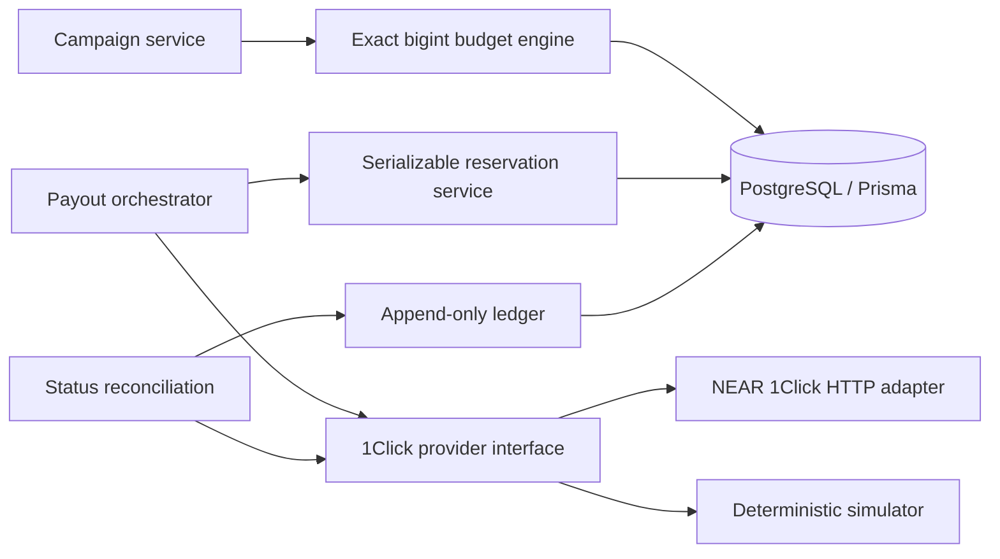
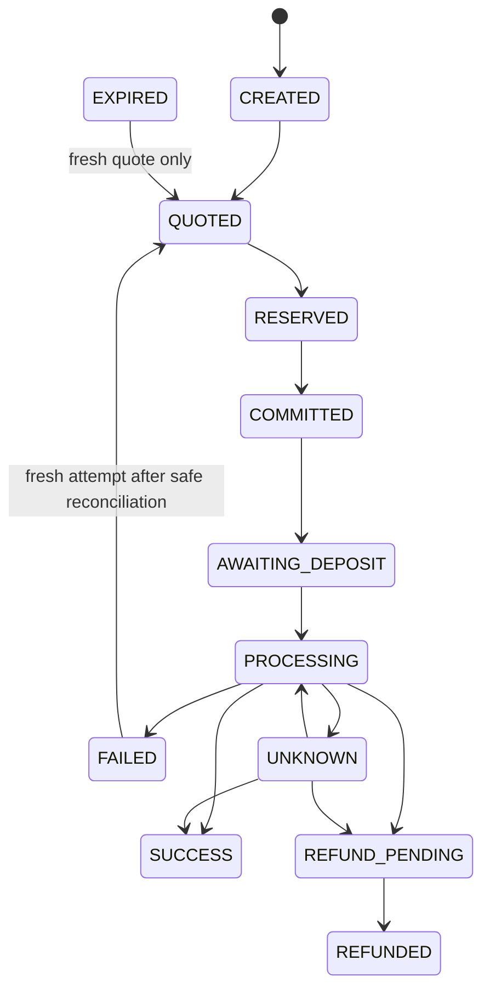

# NEAR Intents Payout Assurance Spike

An engineering proof of concept for recipient-level payout records and conservative campaign budget authorization. It is not a payroll product, does not sign transactions, and does not submit deposits. Real provider integration can request quotes and read status; the executable scenarios use clearly labeled simulated data.

## Architecture





`UNKNOWN` is intentionally nonterminal. A timeout never proves provider rejection. Do not release exposure or create a new funded attempt from that state.

## Financial model and invariants

- Money is represented as positive integer atomic units (`bigint`). Token decimals are metadata and constrained to 0–30; amounts are never parsed through `number`.
- Each campaign has exactly one budget asset denomination. Every `maxAmountIn` and separately payable fee must identify that same asset/chain/precision. Mixed denominations fail closed because no validated valuation or FX risk model is configured.
- Authorization is based on `maxAmountIn`, not `amountIn`. Budget approval rejects if the sum plus explicit separately payable fees exceeds the campaign budget.
- A PostgreSQL row lock and serializable transaction protect the campaign budget check. A unique reservation per payout, unique campaign idempotency key, and unique `(campaignId, recipientId)` prevent duplicate authorization.
- A settlement is accepted only when provider status is `SUCCESS`, actual output equals the promised atomic amount, and actual source spend is present. A confirmed refund is credited only if amount is present, positive, bounded by reserved input, and associated with the quote's origin asset. The status endpoint does not independently identify refund asset; association to the original quote must be preserved.
- Pending refunds do not reduce available funds. Unknown outcomes remain exposed. Cross-chain exactly-once settlement is not claimed; local idempotency cannot control an external solver's behavior.

Ledger reconciliation convention: `available = approved budget − active reservations`; `unresolved = active reservations + observed deposits − confirmed settlement spend − confirmed refunds`. Deposit observations are informational movement into the provider; they do not add a second budget charge because the original reservation remains the exposure until a terminal result. Terminal payout actuals and reservation releases are both retained as separate append-only events. Never treat a pending refund as available.

## NEAR Intents behavior: verified and assumptions

The official 1Click integration page documents base URL `https://1click.chaindefuser.com`, `/v0/quote`, `/v0/status`, optional `/v0/deposit/submit`, and `/v0/tokens`. Quote requests use `dry: true` for a preview and `dry: false` to create a quote with a deposit address. `EXACT_OUTPUT` requests fix the `amount`; the quote provides `amountOut`, `minAmountIn`, and `maxAmountIn`. The implementation verifies echoed swap type/requested amount and that `amountOut` exactly matches the requested amount. Quote deadlines are retained and checked before reservation. See [official 1Click API documentation](https://docs.near-intents.org/near-intents/integration/distribution-channels/1click-api) and [published OpenAPI specification](https://1click.chaindefuser.com/docs/v0/openapi.yaml).

Documented status values include `PENDING_DEPOSIT`, `PROCESSING`, `SUCCESS`, `INCOMPLETE_DEPOSIT`, `REFUNDED`, and `FAILED`; the API schema/SDK also includes `KNOWN_DEPOSIT_TX`. `SUCCESS` and the refund/failure statuses are terminal in the published lifecycle. Status results carry `swapDetails`, including actual input/output, refund amount/reason, deposited amount, and transaction hash arrays where present. Status lookup is keyed by deposit address. This adapter validates those fields with Zod before exposing them to the domain.

Authentication details vary across public documentation surfaces: the official page directs integrators to the Partners Portal for an API key; the official TypeScript SDK documents a JWT bearer token. This adapter accepts an optional bearer JWT and sends it only as `Authorization`; confirm the credential format provisioned for your partner account before live use. The endpoint remains usable for quote requests without this configuration according to public 1Click integration examples, but fee treatment can differ.

The provider's `maxAmountIn` is the quote's source-asset bound; origin-chain network fees paid by the sender are separate and must be added as an explicit fee in the budget denomination. Do not assume an unrelated native gas asset is covered by the quote. The public schema material reviewed here does not establish a universal representation for all fee components or independently identify refund asset, so unsupported fee components and mixed budget assets must be resolved/converted by a separately validated policy before approval. No conversion policy is implemented. API idempotency support is not verified; all uniqueness and retries are therefore enforced locally. The API has no verified testnet deployment; the mock is not a settlement simulation claim.

Preview quotes do not include a deposit address. A committed quote (`dry: false`) returns `quote.depositAddress`, optional `depositMemo`, `deadline`, and `timeWhenInactive`; documented validity is about ten minutes. This spike's committed quote method records the address and never funds it. Deposit submission and signing are deliberately not implemented.

## Database

Prisma models: `Campaign`, `Payout`, `Attempt`, `PayoutEvent`, `Reservation`, and append-only `LedgerEntry`. Database uniqueness constraints cover idempotency, recipients, attempts, quote IDs, reservations, and ledger external references. SQL migration adds positive amount, precision, and nonnegative exposure constraints. Financial writes and status application occur in serializable database transactions.

## Run locally

Requirements: Node.js 20+, pnpm, and Docker Compose.

```sh
cp .env.example .env
docker compose up -d postgres
pnpm install
pnpm db:generate
pnpm db:migrate
pnpm build
pnpm test
pnpm demo
```

`tests/concurrency/reservation.integration.test.ts` runs when `DATABASE_URL` is configured and asserts that only one of two simultaneous 70-unit reservations can succeed against 100 units. Unit tests do not require PostgreSQL. `pnpm demo` prints budget rejection, a 92-unit approval example, partial execution states, concurrent reservation expectations, and duplicate retry behavior; every outcome is simulated.

Set `NEAR_INTENTS_BASE_URL` and optionally `NEAR_INTENTS_JWT` in `.env` for real dry quotes/status reads. Do not put private keys in this application. Never point a transaction signer at these deposit addresses as part of this spike.

## Known limits and next work

- No production wallet, deposit observer, chain finality verification, deposit submission, signing, or funding support.
- The persistence services have been designed for PostgreSQL, but the integration suite must be run against a live local PostgreSQL to validate isolation and Prisma SQL behavior.
- Provider status alone is trusted as settlement evidence in the spike; a production system should independently verify destination-chain transactions/finality and refund transaction provenance.
- Fee coverage/auth pricing must be confirmed with NEAR Intents for the partner account. External gas valuation is intentionally not invented.
- Add durable retry orchestration with provider-status gating, campaign-level reconciliation reports, operational alerts, and audited manual adjustment approval before production.
- No exactly-once cross-chain guarantee is possible from local database idempotency alone.
