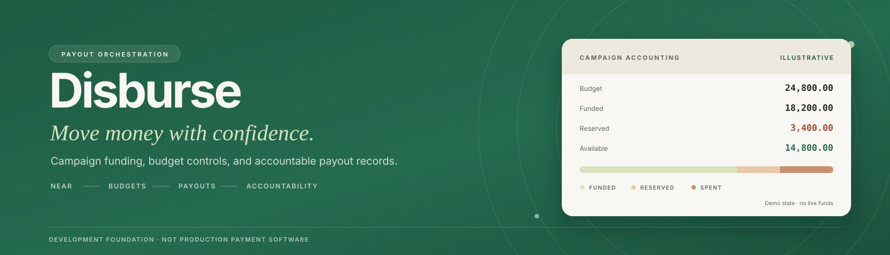
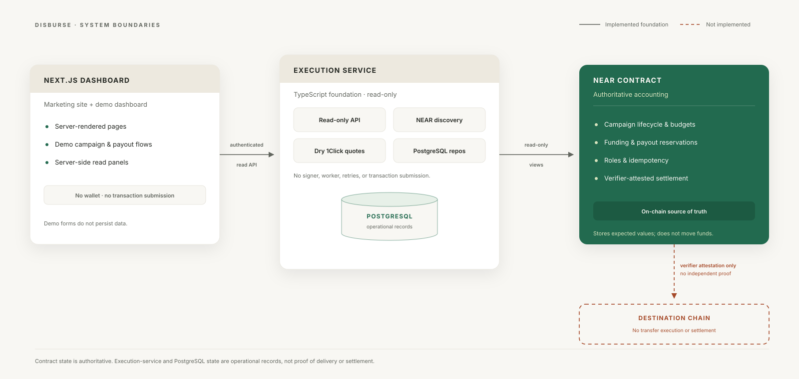
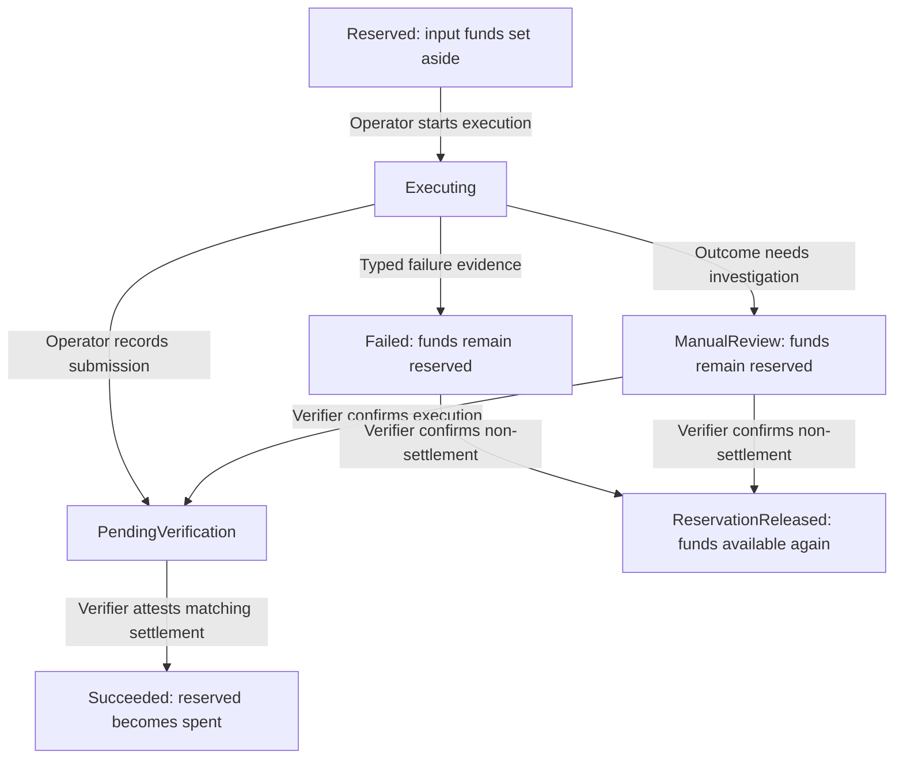
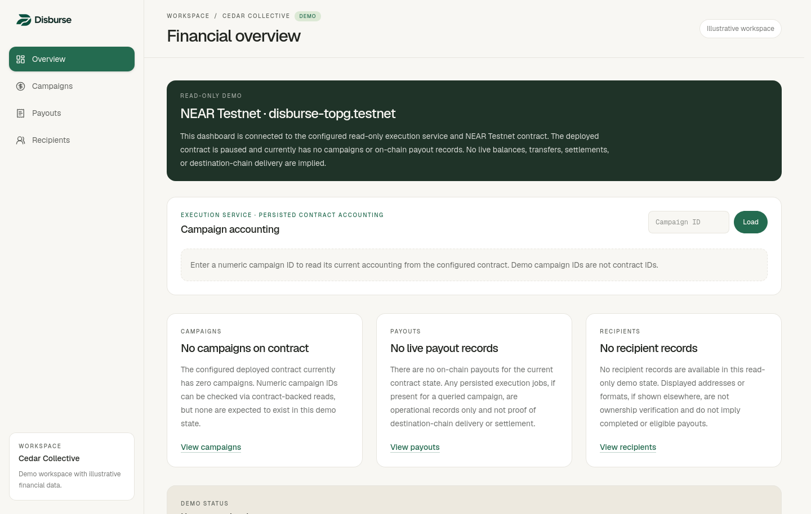

# Disburse

<p align="center">
  
</p>

**Accountable payouts, from campaign budget to settlement record.** Disburse is a NEAR-native payout orchestration project for teams paying freelancers, contributors, and service providers. It brings campaign approval, token funding, payout reservations, and settlement records into one explicit workflow.

<p>
  
  
  
  
</p>

> **Status — development foundation, not production payment software.** Disburse contains a NEAR contract, a read-only execution-service foundation, and a demo-oriented Next.js dashboard. It has no production signer, worker, live payout submission, independent destination-chain verifier, or complete quote-to-settlement pipeline. Do not use it to move production funds.

[Why Disburse](#why-disburse) · [How it works](#how-it-fits-together) · [Quickstart](#quickstart) · [Development](#local-development) · [Documentation](#documentation)

## Why Disburse

Paying a group of contributors involves more than sending tokens. A team needs to know who approved the budget, how much is still available, which payouts have funds set aside, and what evidence supports a completed payment.

Disburse models that process around a **campaign**: a payout budget denominated in one approved NEP-141 token on NEAR. Each **payout** belongs to a campaign and records its input amount, intended destination, output token, and exact expected output amount. The contract reserves the input amount before execution so it cannot be allocated to another payout.

For example, a contributor campaign funded with 1,000 token units could reserve 100 units for a payout. Its available balance becomes 900 while those 100 remain reserved. On verifier-attested success, the 100 move from reserved to spent. If non-settlement is confirmed and the reservation is released, they become available again. Releasing a reservation changes accounting; it does not send a refund.

Amounts in the contract and service use exact atomic units. The numbers above are simplified for illustration. Recording a destination chain does not establish live support for that chain.

## What it does today

| Component | Implemented foundation | Not implemented / not implied |
| --- | --- | --- |
| **NEAR contract** | Campaign lifecycle, approved-token funding, budget accounting, payout reservations, role controls, idempotency, and verifier-attested settlement/recovery | Cross-chain transfer execution or independent destination-chain proof |
| **Execution service** | Read-only NEAR views, runnable authenticated read-only HTTP host, event-discovery components, dry quote previews, and PostgreSQL persistence primitives | A production worker, signer, transaction submission, automatic retries/refunds, or settlement verifier |
| **Frontend** | Marketing site, responsive dashboard, demo campaign/recipient/payout flows, and optional server-side API reads | Wallet connection, persisted form actions, campaign funding, or payout initiation from the UI |
| **PostgreSQL** | Additive migrations and repositories for authorizations, refund policies, jobs, attempts, and leases | Proof of on-chain settlement or a running production service |

Illustrative dashboard records are intentionally separate from contract and execution-service data. A read-only contract view is not proof that a payout was delivered.

## How it fits together

<p align="center">
  
</p>

1. **Plan a campaign.** The contract models a campaign with a token, budget, creator, and lifecycle: `Draft` → `Approved` → `Active`, with pause, completion, and cancellation paths.
2. **Fund within controls.** NEP-141 funding is accepted only for allowlisted tokens, an approved campaign, its matching token, and an amount within its budget.
3. **Reserve a payout.** An Operator or Administrator can create a payout for an active campaign. Its input amount is reserved immediately, subject to campaign accounting invariants.
4. **Record operational state.** The service foundation can retain job, attempt, lease, authorization, and policy records in PostgreSQL. These are operational records, not the contract source of truth.
5. **Settle with an explicit trust boundary.** A Verifier can attest matching destination, output token, and exact output amount. The contract does not independently inspect a destination chain or prove a receipt is genuine.

### Payout lifecycle



*Selected contract paths, not an exhaustive transition map. These calls are implemented in the contract; the service does not automate them. See the [settlement guide](docs/payout-settlement.md) for evidence requirements and recovery rules.*

## Accounting and safety model

The contract is authoritative for campaign funding, reservations, spent input, and payout state. It tracks `budget`, `funded`, `reserved`, `spent`, and `available`, enforcing the accounting invariant:

```text
reserved + spent ≤ funded ≤ budget
available = funded − reserved − spent
```

- Payout creation reserves input funds up front.
- Campaign-scoped idempotency returns the original payout for an identical retry and rejects changed details under the same key.
- Roles are explicit: the owner has implicit Owner and Administrator authority; Operators activate campaigns and create payouts; explicitly assigned Verifiers settle or recover reservations.
- Settlement validates the verifier’s claim against the approved destination, output token, and exact atomic output amount.
- Contract events use NEP-297 `EVENT_JSON:` records.

The payout model includes `Reserved`, `Executing`, `PendingVerification`, `Succeeded`, `Failed`, `RefundPending`, `Refunded`, `ManualReview`, and `ReservationReleased` states. Their presence in code does **not** mean a live provider executes them today.

## Repository map

```text
src/                  NEAR contract, state types, and Rust tests
execution-service/    TypeScript read API, discovery, persistence, providers, and tests
frontend/             Next.js marketing site and demo dashboard
docs/                 Architecture, security, integration, and deployment documentation
docs/assets/          README visuals and the demo dashboard screenshot
```

## Quickstart

Get the demo dashboard running locally:

```sh
git clone https://github.com/Sharon-dev-create/disburse.git
cd disburse/frontend
pnpm install --frozen-lockfile
pnpm dev
```

Open [http://localhost:3000](http://localhost:3000) for the marketing site and [http://localhost:3000/dashboard](http://localhost:3000/dashboard) for the read-only demo dashboard. The dashboard runs without the execution service; its read panels remain in their empty demo state until an API is configured.

<p align="center">
  
</p>

*The read-only demo dashboard. Displayed data is illustrative; no live transfer, balance, or settlement is implied.*

## Local development

### Prerequisites

- **Rust 1.95+**
- **Node.js 22.13+** and **pnpm**
- **PostgreSQL 18** on loopback for real service integration tests
- **cargo-near** only when building WASM

### Contract

From the repository root:

```sh
cargo fmt --all -- --check
cargo test --locked
cargo near build non-reproducible-wasm --locked
```

The build produces an artifact only; it does not deploy a contract.

### Execution service and PostgreSQL

From `execution-service/`:

```sh
pnpm install --frozen-lockfile
pnpm check
```

For isolated local database testing, copy the placeholder configuration and keep it private:

```sh
cp .env.example .env.integration.local
chmod 600 .env.integration.local
```

Configure separate loopback-only development and test roles/databases. Never commit the local file or point these commands at production or shared data.

```text
DISBURSE_DEV_DATABASE_URL=postgresql://disburse_dev:<password>@127.0.0.1:5432/disburse_dev
DISBURSE_TEST_DATABASE_URL=postgresql://disburse_test:<password>@127.0.0.1:5432/disburse_test
```

Then apply additive migrations and run the real isolated integration suite:

```sh
pnpm db:migrate:dev
pnpm db:migrate:test
pnpm test:postgres
```

The PostgreSQL suite validates that it is connected to the dedicated `disburse_test` database and role before writing. It does not silently use mocks or skip database checks.

To run the read-only HTTP host, follow the [service environment setup](execution-service/README.md#environment-setup), configure PostgreSQL, NEAR RPC, the contract ID, and the demo token, then run `pnpm start` from `execution-service/`. The host validates configuration, applies migrations, and checks contract readiness before serving requests. Discovery components and dry quote previews are separate modules; starting the host does not start a payout worker.

### Frontend

From `frontend/`:

```sh
pnpm install --frozen-lockfile
pnpm dev
```

Open `http://localhost:3000`. The dashboard works as a demo without an API. To enable its optional server-side read panels, configure a trusted host-composed API endpoint with `DISBURSE_EXECUTION_API_BASE_URL` and the matching server-only `DISBURSE_EXECUTION_API_DEMO_TOKEN`. See the [frontend environment guide](frontend/README.md#environment-setup) for configuration. Database URLs belong in the service environment; the demo token must never use a `NEXT_PUBLIC_*` variable.

```sh
pnpm lint
pnpm typecheck
pnpm test
pnpm build
```

## Verification commands

| Area | Command |
| --- | --- |
| Contract format and tests | `cargo fmt --all -- --check && cargo test --locked` |
| Contract WASM build | `cargo near build non-reproducible-wasm --locked` |
| Execution-service deterministic checks | `cd execution-service && pnpm check` |
| Execution-service PostgreSQL tests | `cd execution-service && pnpm test:postgres` |
| Frontend checks | `cd frontend && pnpm lint && pnpm typecheck && pnpm test && pnpm build` |

No browser end-to-end suite or all-in-one runtime command is currently included. A passing build or unit test does not establish deployment, transfer execution, cross-chain finality, or settlement readiness.

## Important boundaries

- The contract stores expected output values but does not execute cross-chain transfers.
- The NEAR Intents 1Click adapter requests `EXACT_OUTPUT` quotes with `dry: true`; these are previews, not orders, deposits, or execution guarantees.
- A verifier attestation is a trusted assertion, not independent destination-chain verification.
- PostgreSQL job state is operational state; contract state remains authoritative for on-chain accounting.
- The frontend’s demo forms do not persist data or submit contract transactions.

## Documentation

### Architecture and security

- [Execution-service architecture](docs/execution-service-architecture.md) — component boundaries and data flow
- [Execution-service API](docs/execution-service-api.md) — authenticated read-only HTTP surface
- [Execution security and threat model](docs/execution-security.md) — security model and trust boundaries
- [Execution-service threat model](docs/execution-service-threat-model.md) — assets, abuse cases, and mitigations
- [PostgreSQL setup and schema boundaries](docs/postgres-execution-service.md) — migrations, repositories, and local databases
- [Payout settlement and verifier trust model](docs/payout-settlement.md) — settlement states and attestation limits

### NEAR and settlement

- [NEAR Intents integration boundary](docs/near-intents-integration.md) — dry 1Click quote previews
- [NEAR payout discovery](docs/near-payout-discovery.md) — payout views and event discovery
- [NEAR event indexing](docs/near-event-indexing.md) — indexing boundary and available strategy
- [NEAR discovery integrity](docs/near-discovery-integrity.md) — recovery and integrity checks
- [Event provider evaluation](docs/near-event-provider-evaluation.md) — provider criteria and findings
- [Event provider integration](docs/near-event-provider-integration.md) — integration notes and constraints

### Development and validation

- [Execution service development environment](docs/execution-service-development.md) — local setup and PostgreSQL 18 workflow
- [Testnet deployment readiness](docs/testnet-deployment.md) — deployment prerequisites and gates
- [Milestone 11 testnet validation](docs/testnet-validation.md) — validation record and current blockers
- [Execution service guide](execution-service/README.md) — service-specific setup and commands
- [Frontend guide](frontend/README.md) — dashboard setup and demo limitations

### Architecture decision records

- [ADR-001: Refund custody](docs/decisions/ADR-001-refund-custody.md)
- [ADR-002: Recipient validation](docs/decisions/ADR-002-recipient-validation.md)
- [ADR-003: Exact-output settlement](docs/decisions/ADR-003-exact-output-settlement.md)
- [ADR-004: Signing authority](docs/decisions/ADR-004-signing-authority.md)
- [ADR-005: Destination verification](docs/decisions/ADR-005-destination-verification.md)

## License

No repository `LICENSE` file is present. The root package metadata is private and does not grant a project-wide license. Confirm the intended license with the maintainers before redistributing or relying on the code.
