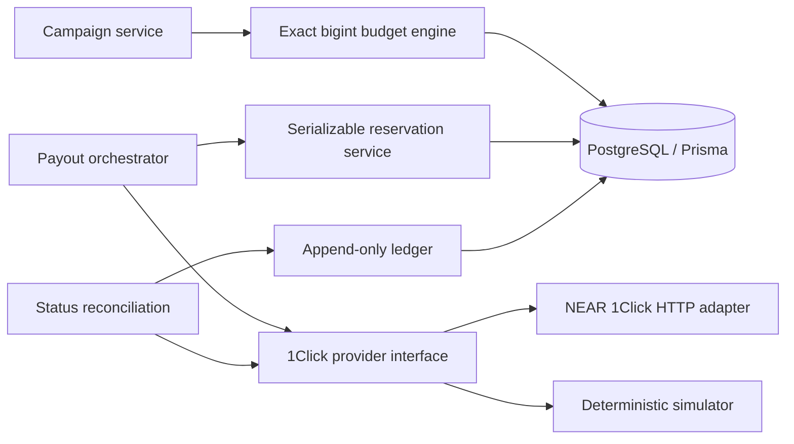
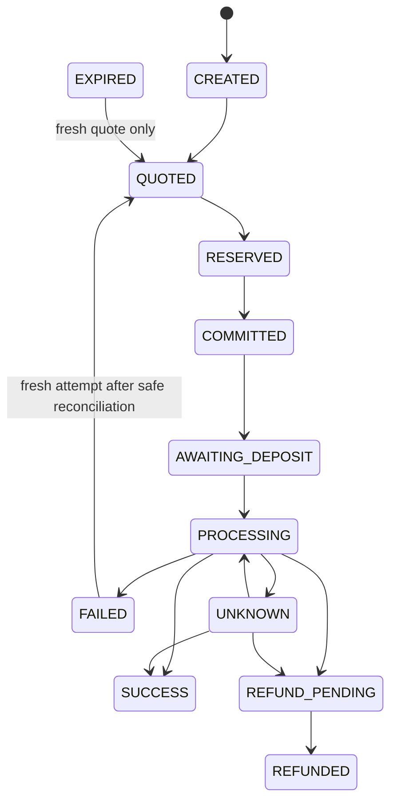

# NEAR Intents Payout Assurance Spike

An engineering proof of concept for recipient-level payout records and conservative campaign budget authorization. It is not a payroll product, does not sign transactions, and does not submit deposits. Real provider integration can request quotes and read status; the executable scenarios use clearly labeled simulated data.

## Architecture





`UNKNOWN` is intentionally nonterminal. A timeout never proves provider rejection. Do not release exposure or create a new funded attempt from that state.

## Financial model and invariants

- Money is represented as positive integer atomic units (`bigint`). Token decimals are metadata and constrained to 0–30; amounts are never parsed through `number`.
- Each campaign has exactly one budget asset denomination. Every quote `amountIn` reservation ceiling and separately payable fee must identify that same asset/chain/precision. Mixed denominations fail closed because no validated valuation or FX risk model is configured.
- Authorization reserves exactly the persisted attempt's `amountIn` buffer (stored internally as `maxAmountIn`), not `minAmountIn`. Every reservation verifies campaign/payout/attempt ownership, denomination, quote eligibility and expiry. Budget approval rejects if the sum plus explicit separately payable fees exceeds the campaign budget.
- `amountIn` is an internal authorization ceiling, **not a provider-enforced cap**. The current 1Click documentation does not promise that an address rejects a larger deposit or that the solver can never consume more. This spike does not submit deposits; a production funding path must independently prevent overfunding and reconcile any observed deposit above the authorization ceiling before allowing further spending.
- A PostgreSQL campaign row lock plus serializable transactions protect budget checks. Bounded retries handle serialization/deadlock errors. Reservations are unique per attempt; campaign idempotency keys and `(campaignId, recipientId)` prevent duplicate campaign/payout creation.
- A settlement is accepted only when provider status is `SUCCESS`, actual output equals the promised atomic amount, and actual source spend is present. A confirmed refund is credited only if amount is present, positive, bounded by reserved input, and associated with the quote's origin asset. The status endpoint does not independently identify refund asset; association to the original quote must be preserved.
- Pending refunds do not reduce available funds. Unknown outcomes remain exposed. Cross-chain exactly-once settlement is not claimed; local idempotency cannot control an external solver's behavior.

Ledger reconciliation is grouped by provider attempt so retries cannot be merged: `attempt exposure = max(remaining active reservation, observed deposit − confirmed refund)`. If no deposit is observed, confirmed settlement/refund records are the fallback source outflow. Campaign `available = approved budget − sum(attempt exposure)` and unresolved deposits remain exposed. Deposits are not double-counted when they become settlements. Only confirmed settlements/refunds lower remaining exposure when an authoritative deposit total is known; a missing or uncertain amount retains the reservation. Campaign-level fees have their own exposure group. Releases are idempotent and ledgered separately with actor/reason metadata for manual reconciliation.

## NEAR Intents behavior: verified and assumptions

The current official API reference documents base URL `https://1click.chaindefuser.com`, `POST /v0/quote`, `GET /v0/status`, optional `POST /v0/deposit/submit`, and `GET /v0/tokens`. Quote requests use `dry: true` for preview and `dry: false` to create a quote/deposit address; the request requires `slippageTolerance`, `deadline`, and explicit deposit/refund/recipient types. `EXACT_OUTPUT` fixes output `amount`; the documented quote response has `amountIn`, `minAmountIn`, `amountOut`, a `signature`, and (for committed quotes) `depositAddress`, optional memo, and deadline. The current docs do **not** define `maxAmountIn`; this adapter maps the documented `amountIn` buffer to its internal reservation ceiling and checks `minAmountIn <= amountIn`. It verifies echoed request assets, recipient, refund target, types, and amount, and verifies exact `amountOut`. Preview responses omit deadline/deposit address; committed responses must include them. Status lookup uses deposit address and must include `depositMemo` when the quote supplies one. See the current [quote reference](https://docs.near-intents.org/api-reference/oneclick/request-a-swap-quote), [status reference](https://docs.near-intents.org/api-reference/oneclick/check-swap-execution-status), [swap type definitions](https://docs.near-intents.org/integration/distribution-channels/1click-api/swap-types), and [published OpenAPI specification](https://1click.chaindefuser.com/docs/v0/openapi.yaml).

Documented status values are `KNOWN_DEPOSIT_TX`, `PENDING_DEPOSIT`, `INCOMPLETE_DEPOSIT`, `PROCESSING`, `SUCCESS`, `REFUNDED`, and `FAILED`. Status results carry `swapDetails`, including actual input/output, `refundedAmount`, refund reason, `depositedAmount`, and origin/destination transaction hashes where present. This adapter validates those fields and the echoed quote using Zod before exposing them to the domain.

The current official authentication page says partner JWTs are sent as `X-API-Key` (and `Authorization: Bearer` is also accepted). The adapter sends the optional `NEAR_INTENTS_JWT` as `X-API-Key`. Unauthenticated quotes are allowed but incur an additional 25 bps platform fee; authenticated standard pricing is typically 20 bps, or 1 bp for stablecoin and same-asset multichain routes. The documented 0.0001% on-chain protocol fee applies separately; `appFees` and the optional insured-swap fee add further fee rules. The partner fee schedule is configurable. See [official API key guidance](https://docs.near-intents.org/integration/distribution-channels/1click-api/authentication) and [official fee schedule](https://docs.near-intents.org/resources/fees).

The adapter uses quote `amountIn` as the campaign's source-asset reservation ceiling. The exact-output reference describes it as the proposed input with a slippage buffer and says excess above actual need is refunded. The SDK defines `refundFee` in origin-asset units and `withdrawFee` in destination-asset units (already included in final `amountOut`); this adapter still rejects nonzero fee fields until an asset-aware fee policy exists. Origin-chain transaction gas paid by the sender is separate and must be budgeted in its own asset; do not assume unrelated native gas is covered. Mixed budget assets fail closed without validated conversion. API idempotency support is not documented; uniqueness/retries are enforced locally. The quote signature is stored but cryptographic verification is not implemented. The API has no documented testnet deployment; the mock is not a settlement simulation claim.

Preview quotes do not include a deposit address or expiry. A committed quote (`dry: false`) returns `quote.depositAddress`, optional `depositMemo`, `deadline`, and `timeWhenInactive`; expiry is determined by the quote/request deadline rather than a hard-coded duration. This spike's committed quote method records the address and never funds it. Deposit submission and signing are deliberately not implemented.

## Database

Prisma models: `Campaign`, `Payout`, `Attempt`, `PayoutEvent`, `Reservation`, and append-only `LedgerEntry`. Database uniqueness constraints cover idempotency, recipients, attempts, quote IDs, reservations, and ledger external references. SQL migration adds positive amount, precision, and nonnegative exposure constraints. Financial writes and status application occur in serializable database transactions.

## Run locally

Requirements: Node.js 20+, pnpm, and Docker Compose.

```sh
cp .env.example .env
docker compose up -d postgres
pnpm install
pnpm db:generate
pnpm db:migrate
pnpm build
pnpm test
pnpm demo
```

`tests/concurrency/reservation.integration.test.ts` requires a reachable PostgreSQL database in `DATABASE_URL` and fails explicitly if the prerequisite is missing. It covers concurrent budget limits, campaign/payout/attempt ownership, quote bounds and expiry, idempotent release, serialization retries, settlement/deposit overlap, partial refunds and unresolved/uncertain outcomes. `pnpm demo` prints budget rejection, a 92-unit approval example, partial execution states, concurrent reservation expectations, and duplicate retry behavior; every outcome is simulated.

Set `NEAR_INTENTS_BASE_URL` and optionally `NEAR_INTENTS_JWT` in `.env` for real dry quotes/status reads. Do not put private keys in this application. Never point a transaction signer at these deposit addresses as part of this spike.

## Known limits and next work

- No production wallet, deposit observer, chain finality verification, deposit submission, signing, or funding support.
- Funding-control feasibility findings and a simulated pre-sign policy-gate PoC are documented in [docs/FUNDING-CONTROL.md](docs/FUNDING-CONTROL.md); the simulation does not enable real funding.
- Provider status remains the source of deposit, settlement and refund evidence in this spike; a production system should independently verify chain transactions and finality before reducing exposure.
- Provider status alone is trusted as settlement evidence in the spike; a production system should independently verify destination-chain transactions/finality and refund transaction provenance.
- Fee coverage/auth pricing must be confirmed with NEAR Intents for the partner account. External gas valuation is intentionally not invented.
- Add durable retry orchestration with provider-status gating, campaign-level reconciliation reports, operational alerts, and audited manual adjustment approval before production.
- No exactly-once cross-chain guarantee is possible from local database idempotency alone.
