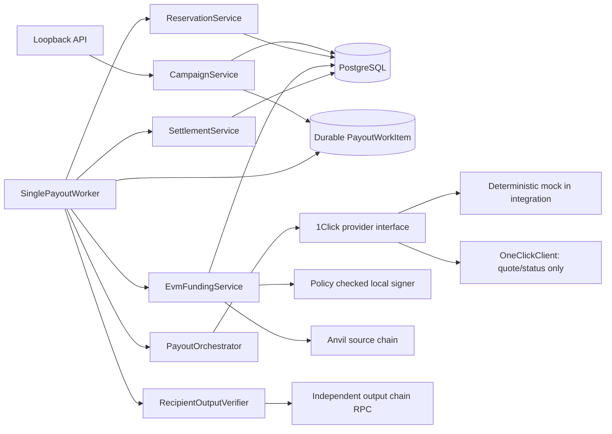

# Single-payout lifecycle spike

**Decision: simulated/local GO; production NO-GO.** The integration proves the software lifecycle with PostgreSQL, local Anvil, and a deterministic provider mock. It does not prove that NEAR Intents will settle a live quote, that a production signer is isolated, or that a non-EVM output chain has verified settlement.

## Architecture



The runtime API binds to `127.0.0.1` and only creates draft campaigns, approves campaigns, creates idempotent payout requests, and reads payout evidence. It does not sign or submit funding. The worker is a PostgreSQL-backed service with `processOne()` and a stoppable polling `run()` loop; integration tests instantiate it with local Anvil and a deterministic mock.

## State and evidence separation

Three independently persisted facts are kept distinct:

| Concern | Persisted state |
|---|---|
| Payout orchestration | `Payout.status` and append-only `PayoutEvent` transitions |
| Provider execution | `Attempt.providerStatus` and timestamp; provider-reported settlement/refund ledger entries are labeled as reports |
| Source funding | `EvmFundingOperation.state`, nonce, transaction hash, and observed block evidence |
| Recipient output | `Payout.recipientOutputState`, output transaction hash, block hash, and verification time |

The simulated successful path persists `CREATED → QUOTED → RESERVED → COMMITTED → AWAITING_DEPOSIT → PROCESSING → SUCCESS`. `SUCCESS` is written only after a confirmed EVM source operation, a provider terminal success matching the quote, and a separate output-chain verifier confirms the exact asset, recipient, and promised amount. A provider `SUCCESS` without output proof is recorded as `PROVIDER_SETTLEMENT_REPORTED`; payout stays `PROCESSING`, output state stays `PENDING`, and reservation exposure remains.

Provider refund reports are stored as `PROVIDER_REFUND_REPORTED`. They do not release funds. This milestone has no independent origin-chain refund verifier, so refund/no-spend outcomes remain unresolved and move to manual review after bounded retries.

## Service responsibilities and database relationships

- `CampaignService` creates a `DRAFT` campaign, approves its budget, and creates one payout plus its durable work payload under an idempotency key. Payout quote payload must match the campaign input asset, exact promised amount, destination asset, and recipient.
- `PayoutOrchestrator` requests a committed `EXACT_OUTPUT` quote, verifies the persisted payout fields, minimum/maximum input relationship, deadline, deposit address, and exact output, then records the attempt and quote ID. It never sends the quote deposit.
- `ReservationService` reserves the persisted quote ceiling under its existing serializable campaign lock and exposure checks.
- `EvmFundingService` creates one funding journal linked to campaign, payout, attempt, quote and reservation. It uses the configured source asset/chain, deposit address and memo. The EVM token transfer cannot encode a provider memo, so any quote requiring one fails closed.
- `PolicyCheckedAnvilSigner` reloads the reservation and associations immediately before signing. It permits a canonical exact ERC-20 transfer and rejects approvals, other calls, native value, wrong destination/asset/chain, and excess amount. `EvmFundingService` persists encrypted signed bytes and rebroadcasts only those same bytes after uncertain outcomes.
- `EvmRecipientOutputVerifier` independently checks provider-reported output transaction evidence against an allowlisted token, recipient, exact amount, receipt, canonical block and confirmation depth. This implementation only verifies local Anvil EVM outputs.
- `SettlementService` records provider status separately, requires confirmed source funding and valid recipient evidence before terminal payout success, and applies reservation/ledger effects atomically.
- `PayoutWorkItem` is unique per payout and type. PostgreSQL `FOR UPDATE SKIP LOCKED`, lease tokens, expiry recovery, durable payloads, bounded attempts and capped exponential backoff protect concurrent workers and process restarts. Expiry never releases exposure. Exhausted work is `MANUAL_REVIEW` and the payout moves to `UNKNOWN` only if that transition is allowed.

Database links are `Campaign → Payout → Attempt → Reservation → EvmFundingOperation`; `PayoutWorkItem` references its payout. `LedgerEntry` is append-only and carries quote/operation/output evidence references. The migration is additive; it adds source-chain identity, payout idempotency, output verification fields, provider-report ledger types, the durable queue and quote/memo association for funding operations.

## Recovery and failure handling

1. A worker claims a due work row with a unique lease token. An expired lease can be reclaimed after a process restart.
2. Quote, reservation, funding journal, and transaction evidence are committed as durable checkpoints. The quote request itself is saved in the work payload.
3. If a source broadcast result is uncertain, the worker reconciles by transaction hash and retries only the same encrypted signed transaction. It does not allocate a replacement transaction.
4. If source confirmation is delayed or RPC/provider status is unavailable, the job backs off and the reservation remains active.
5. A provider result that disagrees with persisted asset, recipient, quote maximum, or exact output remains unresolved or is rejected. No provider-only status can set recipient output to `VERIFIED`.
6. A destination receipt without sufficient confirmation depth is retried. A wrong token, recipient, amount, or receipt moves work toward manual review and does not produce `SUCCESS`.
7. Reorg/source uncertainty remains exposed through the existing EVM funding journal and reservation guards. Worker retry exhaustion marks manual review; it does not automatically release funds.

## Provider and chain assumptions

The integration uses `MockProvider` as a deterministic fixture. Its returned “success” is only an input to the workflow; the recipient output test transaction is separately written to local Anvil and independently verified. The mock does not emulate or certify 1Click solver behavior.

`OneClickClient` remains the read/quote adapter. No live deposit address is funded or submitted by this milestone. The EVM adapter rejects every RPC except local Anvil chain ID `31337`, and the test token is a plain local ERC-20. The local signer shares a process with policy code; a process compromise can bypass it. Do not treat this as a production signer boundary.

The exact EVM source transfer and output transfer are proven only for standard allowlisted ERC-20s on the local EVM. Non-EVM source chains, token fee/rebase behavior, L2 fee models, smart-account behavior and non-EVM destination proofs are not supported. Without a configured recipient-output verifier, provider success stays unresolved and is never described as a fully guaranteed payout.

## API surface

Run `pnpm api` after database setup. It binds only to `127.0.0.1` (default port `8787`; override with `API_PORT`). Requests creating campaigns and payouts require an `Idempotency-Key` header.

- `POST /campaigns`
- `POST /campaigns/:id/approve`
- `POST /campaigns/:id/payouts`
- `GET /payouts/:id`
- `GET /payouts/:id/attempts`
- `GET /payouts/:id/funding`
- `GET /payouts/:id/reconciliation`

Atomic amounts are decimal strings. No dashboard or public-network funding endpoint is included.

## Local verification

```sh
docker compose up -d postgres
pnpm exec prisma migrate deploy
pnpm exec prisma generate
pnpm run build
pnpm test
anvil --silent --port 18545
pnpm run test:evm
```

The EVM integration suite deploys disposable test tokens to local Anvil and writes only to that local chain. The PostgreSQL integration tests require `DATABASE_URL`. No production key, mainnet, real provider deposit, or production funding path is used.
