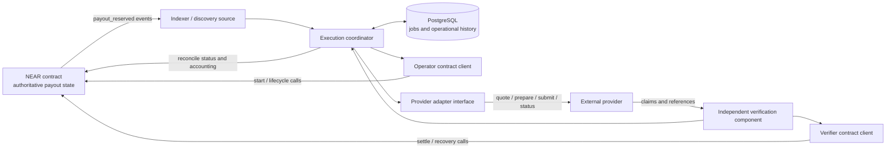

# Execution service architecture

## Status and scope

Milestone 8 added provider-neutral execution boundaries, an operational state machine,
deterministic mock adapters, and a reference PostgreSQL schema. Milestone 9 adds a read-only NEAR
JSON-RPC client, strict event decoder, replayable event-source interface, durable single-writer
local index, discovery processor, and contract-view reconciler. PostgreSQL migrations now provide
durable security repositories and a job/attempt/lease repository. This is a persistence-only
foundation: there is no production worker, destination-chain verification, or transaction
submission. The Rust contract remains the authority for
reservations, campaign accounting, payout state, settlement, and release.

`execution-service/sql/migrations` contains additive, checksummed migrations. Only the security
repository and execution-job tables are migrated; the additional provider, verification,
settlement, error, and reconciliation tables in `sql/schema.sql` remain reference-only.

## Components

### NEAR contract

The contract owns payout status and campaign accounting. A service job is only a durable record of
coordination work. Before acting on a queued job, the coordinator rereads the payout and checks
the status and relevant destination/amount fields. After each signed call, it rereads contract
state; a local transaction response or database state is not proof that the chain transition
committed.

### Discovery and coordinator

`NearDiscoveryCoordinator` wires an event source, read-only contract reader, durable repository,
processor, and reconciler. The processor reads `payout_reserved` and lifecycle events, fetches the
current contract view, and inserts an operational job under
`(network_id, contract_id, payout_id)` only while that view says `Reserved`. Lifecycle events refresh
observations without directly transitioning an execution job. The local repository atomically
persists event, observation, optional job, and cursor, and can resume after restart. It is a
single-writer local file store. The internal PostgreSQL repository supports durable job creation,
claiming, attempts, failure metadata, leases, and recovery, but is not wired to a worker or
event-indexer transaction.

The current ABI has payout, idempotency, accounting, pause, and role views, but no paginated payout
listing or payout count. `get_campaign_count()` is for campaigns, not payouts. The source and
generated ABI were checked. A complete historical feed therefore requires an independently
operated NEAR event indexer with replayable cursors. The package defines this boundary and includes
only a deterministic mock. Historical discovery, completeness, and gap detection are not claimed
until a provider adapter with documented retention, finality, and reorg behavior is selected and
integrated. See [`near-payout-discovery.md`](near-payout-discovery.md) and
[`near-event-indexing.md`](near-event-indexing.md).

### Provider adapter and verification

`ExecutionProviderAdapter` separates validation, quote, preparation, submission, status lookup,
and evidence retrieval. A provider response is an untrusted claim. `SettlementVerifier` is a
separate boundary that must independently check destination chain, recipient, output token,
atomic output amount, success/finality, relevant event identity, provider reference, and evidence
consistency before producing verified normalized evidence. If evidence is missing, inconsistent,
or cannot be independently checked, the job goes to ManualReview. No live adapter or verifier is
implemented here.

Adapters declare idempotency and lookup capabilities explicitly. A capability must remain
`unknown` until a provider contract and observed behavior establish it. The coordinator must not
interpret a client-generated idempotency key as proof that the provider deduplicates requests.

### Contract client and signer separation

`ContractReader` contains read calls. `OperatorContractWriter` contains execution/lifecycle calls
and has no settlement method. `VerifierContractWriter` contains settlement/recovery calls and is a
separate capability. Implementations must use separately authorized signer accounts or a
policy-controlled signing service; an Operator key cannot be used as a Verifier just because it
can start execution. Role assignments are checked with `has_role(account_id, role)` and still
enforced by the contract.

The contract allows Operator or Administrator to create payouts and start execution. Starting
execution is blocked while globally paused. `mark_payout_pending_verification` is also an
Operator/Administrator call and records submission/acknowledgement, not proof of settlement.
`mark_payout_failed` and `move_payout_to_manual_review` are privileged operational attestations.
Only explicitly assigned Verifiers can settle or perform Milestone 7 recovery. Settlement and
recovery remain available during global pause for reconciliation of already-existing payouts.

## Contract integration surface

The table was checked against `src/lib.rs` and the generated `target/near/disburse_contract_abi.json`.
IDs below use the source's `u64`/ABI `uint64`; token atomic amounts use `u128`/`U128` JSON strings.
The service models IDs and amounts as decimal strings to avoid JavaScript precision loss. The
future RPC decoder must preserve the original JSON integer lexemes or reject values it cannot
decode exactly.

| Method | Actual signature / result | Access and contract effect |
|---|---|---|
| `create_payout` | `(campaign_id, idempotency_key, recipient_near_account_id, destination, input_amount, expected_output_amount) -> u64` | Operator/Admin; reserves input funds immediately and emits `payout_reserved`; blocked while paused. Idempotency is campaign-scoped. |
| `get_payout` | `(payout_id) -> Option<PayoutView>` | Read by ID; includes status, destination, amounts, execution reference, and stored evidence. |
| `get_campaign_payout` | `(campaign_id, payout_id) -> Option<PayoutView>` | Read by campaign and payout IDs. |
| `get_campaign_payout_accounting` | `(campaign_id) -> Option<CampaignPayoutAccounting>` | Read budget, funded, reserved, spent, available. |
| `start_payout_execution` | `(payout_id, execution_reference) -> ()` | Operator/Admin; `Reserved → Executing`, globally unique reference, blocked while paused. It does not submit a provider transaction. |
| `mark_payout_pending_verification` | `(payout_id) -> ()` | Operator/Admin; `Executing → PendingVerification`, blocked while paused; not proof of execution success. |
| `mark_payout_failed` | `(payout_id, ExecutionFailureEvidence) -> ()` | Operator/Admin; records asserted definitive failure; no independent chain lookup. |
| `move_payout_to_manual_review` | `(payout_id, reason) -> ()` | Operator/Admin; `Executing` or `PendingVerification → ManualReview`; available while paused. |
| `settle_payout` | `(payout_id, SettlementEvidence) -> ()` | Explicit Verifier only; `PendingVerification → Succeeded`; checked evidence and accounting, available while paused. |
| `release_failed_payout_reservation` | `(payout_id, PayoutResolutionEvidence) -> ()` | Explicit Verifier only; requires typed failure evidence; releases reservation after non-settlement attestation. |
| `confirm_manual_review_execution` | `(payout_id, PayoutResolutionEvidence) -> ()` | Explicit Verifier only; `ManualReview → PendingVerification`, preserving reservation. |
| `release_manual_review_reservation` | `(payout_id, PayoutResolutionEvidence) -> ()` | Explicit Verifier only; releases reservation after definite non-settlement attestation. |

Relevant NEP-297 events include `payout_reserved`, `payout_execution_started`,
`payout_pending_verification`, `payout_execution_failed`, `payout_manual_review`,
`payout_settled`, `failed_payout_reservation_released`,
`manual_review_execution_confirmed`, and `manual_review_non_settlement_confirmed`.

The contract stores a bounded `execution_reference` but does not prove that a provider accepted it
or treated it idempotently. Settlement evidence is a Verifier attestation, not trustless external
chain verification. `ReservationReleased` is terminal. Failed and uncertain jobs must not release
funds unless a Verifier submits structured non-settlement evidence.

## Operational states and mapping

Operational job states do not change NEAR contract states. They describe service progress only.

| Operational state | Meaning / common contract observation |
|---|---|
| `Discovered` | A finalized reserved event was observed; reread payout before queueing. |
| `Queued` | Durable work item; payout must still be `Reserved`. |
| `Leased` | One worker owns a time-bounded lease and fencing token. |
| `Preparing` | Validate request, obtain quote, prepare; no external submission yet. |
| `SubmissionStarted` | Submission intent and attempt are durably recorded before the provider call; contract is normally `Executing`. |
| `SubmissionUnknown` | Provider may have accepted the request but outcome is ambiguous. Never blindly resubmit. |
| `Submitted` | Provider acceptance was reconciled and its references were persisted. Contract may still be `Executing`. |
| `ConfirmationPending` | Waiting for destination-chain completion/finality. |
| `VerificationPending` | Provider reports an outcome; independent evidence assessment is required. Contract may be `PendingVerification`. |
| `SettlementReady` | Independent verifier passed; contract is reread as `PendingVerification`. |
| `SettlementSubmitted` | Verifier transaction intent and response are being reconciled. |
| `Completed` | Contract reread reports `Succeeded`. |
| `RetryableFailure` | A known safe retry exists, normally before external submission or after definitive provider non-acceptance. |
| `ManualReview` | Outcome is ambiguous, evidence insufficient, or safe automated reconciliation unavailable. |
| `Abandoned` | Contract reread reports terminal `ReservationReleased`; this is not a refund. |

The TypeScript transition validator enforces key guards: only `Reserved` can be queued; accepted
provider outcome is required for `Submitted`; unknown outcomes cannot become retryable failures;
independent verification is required for `SettlementReady`; `Completed` requires on-chain
`Succeeded`; and `Abandoned` requires on-chain `ReservationReleased`.

### Transition operation summary

| Transition | Trigger and persistent write | Provider call | NEAR call | Retry / human action |
|---|---|---|---|---|
| `Discovered → Queued` | Event plus fresh `Reserved` read; insert unique job and cursor in one DB transaction. | None | Read only | Duplicate event returns existing job. |
| `Queued → Leased → Preparing` | Atomic lease claim, attempt/version update. | Validate, quote, prepare | Read current payout/pause | Lease can expire; fencing token rejects stale worker writes. |
| `Preparing → SubmissionStarted` | Persist stable reference, idempotency key, request hash, attempt. | None yet | Operator `start_payout_execution`; reread `Executing`. | Start call unknown: reread contract before retrying call. |
| `SubmissionStarted → Submitted` | Persist response/provider references. | Submit response accepted or reconciled lookup | Operator `mark_payout_pending_verification` when submission is acknowledged; reread. | Provider acceptance is not settlement. |
| `SubmissionStarted → SubmissionUnknown` | Persist ambiguous outcome and stop automatic submission attempts. | Timeout/connection loss | None unless independently known submitted | Reconcile only by a verified provider lookup; otherwise ManualReview. |
| `SubmissionUnknown → Submitted` | Persist lookup result and references. | Status/reference lookup | Operator records pending verification if appropriate | No second submit merely due to timeout. |
| `SubmissionUnknown → RetryableFailure` | Persist definitive non-acceptance. | Lookup must establish not accepted | May need Operator failure record depending current contract state | Retry only after safe retry decision; otherwise ManualReview. |
| `Submitted → ConfirmationPending → VerificationPending` | Persist provider state and evidence pointer/hash. | Status/evidence retrieval | Read payout; operator can mark `PendingVerification` only under allowed transition | Provider success alone does not progress to SettlementReady. |
| `VerificationPending → SettlementReady` | Persist independent verification result and normalized claims. | No new submit | Read `PendingVerification` | Insufficient/inconsistent claims escalate to ManualReview. |
| `SettlementReady → SettlementSubmitted` | Persist settlement attempt before signed call. | None | Explicit Verifier `settle_payout` | On lost response, read payout/evidence; do not infer failure. |
| `SettlementSubmitted → Completed` | Persist chain observation and accounting reconciliation. | None | Read `Succeeded` and accounting | Requires authoritative chain state. |
| `SettlementSubmitted → SettlementReady` | Persist proven failed NEAR transaction and unchanged `PendingVerification`. | None | Read contract; confirm prior tx failed | Retry only same verified evidence; unknown result goes to ManualReview. |
| `* → ManualReview` | Persist reason, observations, and error history. | Maybe status lookup | Operator may `move_payout_to_manual_review`; never use timeout as failure evidence | Human/verifier reconciliation. |
| `ManualReview → VerificationPending` | Persist verifier resolution and evidence. | No submit | Verifier `confirm_manual_review_execution`; reread `PendingVerification` | Normal independent verification and settlement follow. |
| `ManualReview → Abandoned` | Persist final resolution/history. | No submit | Verifier releases reservation; reread `ReservationReleased` | Terminal operational outcome. |

The validator does not authorize signed contract calls. Implementations still validate signer
roles, on-chain status, pause policy, and transaction finality at the client boundary.

## Crash, retry, and consistency rules

1. **Before provider submission:** the request and stable reference are in PostgreSQL first. If
   no submit intent was persisted, restart may continue preparation after rereading the contract.
2. **During submission or lost response:** record `SubmissionUnknown`. Query using the stable
   execution reference only if the provider has a documented lookup capability. If the provider
   cannot safely identify the request, escalate to ManualReview. Do not resubmit.
3. **Provider accepted, response lost:** reconciliation must find the existing provider execution
   before continuing. A generated idempotency key is not enough unless provider behavior is
   established.
4. **Provider success with no adequate evidence:** remain in `VerificationPending` or
   `ManualReview`; do not call `settle_payout`.
5. **Database write committed, NEAR transaction failed:** read contract state and transaction
   outcome before retrying. Keep the signed operation attempt and chain receipt in history.
6. **NEAR transaction succeeded, response lost:** reread payout. `Succeeded` means completed;
   another settle call must not be inferred necessary.
7. **Duplicate discovery:** unique `(network, contract, payout)` and source event identity prevent
   duplicate jobs; database transaction commits event cursor with enqueue.
8. **Concurrent workers:** claim with row locking/`SKIP LOCKED`, a unique lease row, expiry, and
   monotonically increasing fencing token. Every write checks the active token and job version.
9. **Paused/manual-review payout:** reread contract before provider calls. Do not start a new
   execution while paused or when status left `Reserved`/`Executing`. Existing reconciliation
   remains possible.
10. **Exactly once:** a crash can occur after a provider accepts a transaction but before the
    service persists the response. Without provider idempotency and lookup guarantees, the service
    cannot distinguish “not submitted” from “accepted, response lost.” Use at-least-once job
    processing with deduplication and reconciliation, but never at-least-once external submission
    for an ambiguous outcome.
11. **Settlement call unknown:** hold `SettlementSubmitted`, reread payout and transaction
    outcome. Only retry after a definitive failed NEAR transaction and unchanged
    `PendingVerification`; if unclear, ManualReview.

The service cannot invent provider cancellation, lookup, idempotency, or finality guarantees.
Each future adapter must document these facts and report unsupported/unknown capabilities
explicitly.

## PostgreSQL responsibilities

The applied migrations create:

- `execution_jobs`: composite payout identity, dedicated job-creation idempotency key, immutable
  canonical payout snapshot and digest, exact atomic amounts, operational state/version, monotonic
  fencing counter, safe failure metadata, discovery identity, and eligibility timestamp.
- `execution_attempts`: ordered attempts with per-job attempt-key and idempotency constraints.
- `job_leases`: one current worker lease per job with database timestamps and fencing token.
- `execution_authorizations` and `payout_refund_policies`: authorization lifecycle and immutable
  payout-bound refund policy records from migration `0001`.

The remaining objects in `sql/schema.sql` are reference-only:

- `provider_references`: provider-scoped external references and optional transaction/event IDs.
- `verification_records`: independent verdict, normalized claims, evidence reference/hash, and
  method; no raw receipt payload.
- `settlement_submission_attempts`: future Verifier signer, evidence reference/hash, tx hash, and
  transaction outcome.
- `processing_errors` and `reconciliation_history`: future error/reconciliation audit trail.

Job idempotency is distinct from contract payout creation and provider idempotency. Same key and
same protected payload returns the existing job; a changed payload conflicts. A payout identity
with an identical snapshot cannot create a second job, even under a different job-creation key.
There is no foreign key to an invented local payout ledger; a discovery observation is not
authoritative current contract state.

The implemented repository uses transactions for job creation, attempt updates, transitions,
lease operations, and expired-lease recovery. Claims use `SELECT ... FOR UPDATE SKIP LOCKED`.
Every lease-protected write checks the owner, current fencing token, expected state version, and
database-time expiry. Expired pre-submission `Leased` work can be reclaimed. Other ambiguous or
post-submission states move to `ManualReview` when permitted by the central state machine;
terminal states remain terminal. Recovery never releases a contract reservation. Amounts and IDs
are stored as exact decimal values/strings, not floating point. Do not store signer private keys,
provider secrets, raw receipts, or unbounded proof blobs in these tables.

PostgreSQL is not a financial ledger. If DB and chain disagree, the contract wins. Record the
disagreement and reconcile; never edit job status to imply a chain transition that did not occur.

## Workflow and failure paths

1. An Operator/Admin creates a payout. The contract reserves the input amount and emits
   `payout_reserved`.
2. An indexer consumes the finalized event, fetches `get_payout`, and creates the unique job.
3. A leased worker rereads state and validates payout destination, tokens, amounts, campaign
   accounting/status as needed, global pause, provider support, and allowed execution route.
4. It creates a deterministic bounded execution reference from network/contract/payout identity.
   It calls `start_payout_execution` with an Operator/Admin signer and confirms `Executing`.
5. Before external submission it persists a `SubmissionStarted` attempt. Provider quote,
   preparation, submission, confirmation, and evidence retrieval are separate adapter operations.
6. A definitive pre-submit rejection can be recorded through `mark_payout_failed` with valid
   typed evidence; an external timeout or missing response instead becomes `SubmissionUnknown`
   or ManualReview.
7. A definitive external revert requires independent verification. Operator/Admin may record
   typed failure; the reservation remains until an explicit Verifier release attestation.
8. An ambiguous result remains reserved and moves to ManualReview. No automatic second payment.
9. Verified execution evidence is converted into the contract's `SettlementEvidence` by a
   separately authorized Verifier client. `settle_payout` is the only path to `Succeeded`.
10. A confirmed ManualReview execution returns to `PendingVerification` and then follows the same
    evidence and settlement path. Verified non-settlement can release the reservation via the
    Verifier recovery methods; this does not transfer/refund tokens.
11. The service rereads payout and campaign accounting before marking the operational job
    Completed or Abandoned.

## Implemented foundation and next milestones

The separate `execution-service` package implements the typed job/payout models, transition
validation, repository and lease interfaces, in-memory and PostgreSQL repositories,
provider-neutral adapter and verification interfaces, read/operator/verifier contract client
boundaries, stable reference generation, and deterministic mocks/tests. The PostgreSQL job
repository is exposed only through internal composition. It does not implement a worker loop,
provider execution, signing, settlement, or destination verification.

Future milestones before any testnet execution:

1. **Payout discovery/indexing:** operate a finalized event indexer with historical replay,
   checkpoint durability, duplicate/reorg behavior, and lossless `u64` decoding; consider a
   contract listing view only after review.
2. **NEAR contract client:** implement RPC reads, transaction status reconciliation, typed ABI
   codec, and separate Operator and Verifier signing capabilities.
3. **Job/event-indexer integration:** define the authorization and contract-revalidation boundary,
   then atomically integrate discovered cursor updates with the PostgreSQL job repository.
4. **NEAR Intents adapter:** research its documented request lifecycle, idempotency, lookup,
   cancellation, and evidence model before implementing any calls.
5. **Destination-chain verification:** independent RPC/indexer sources, finality/reorg policy,
   token/recipient/amount matching, and content-hash/reference construction.
6. **Secure signer integration:** reviewed custody/policy boundary for distinct Operator/Admin and
   Verifier authority; no private-key storage in service DB or source.
7. **End-to-end testnet execution:** test duplicate events, crashes, unknown submissions, settlement
   ambiguity, manual review, and recovery without production funds.
