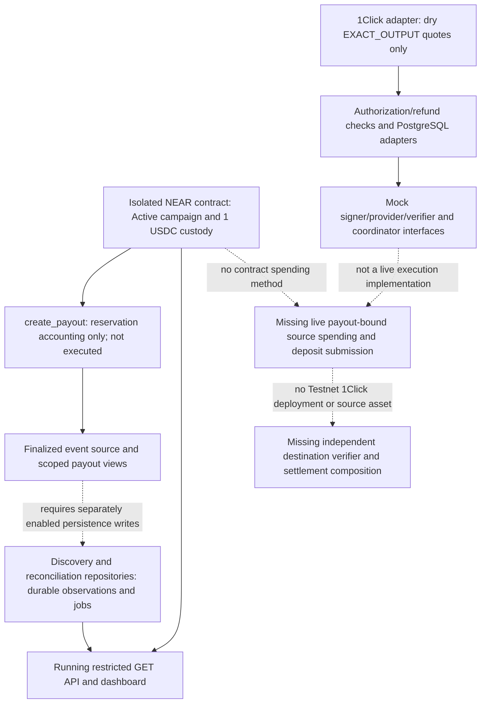

# Milestone 4-B — end-to-end payout routing feasibility

**BLOCKED: no genuine end-to-end Testnet route qualifies.**
M4-A independently passed first. Campaign 0 is now Active; the prior Approved-state
blocker is resolved. No payout reservation, execution, token transfer, settlement,
refund, authorization creation, PostgreSQL write or worker start occurred in M4-B.
No application source, environment, architecture or deployment was modified.

Repository baseline: `913ae89e627c287af176aa9b0e6f9e4091d68ab7`, clean main tracking
origin/main. Inspection: 2026-11-15 UTC. Provider observations around 17:39 UTC;
exact timestamps, HTTP statuses and content hashes are in
[provider observations](evidence/milestone-4/provider/observations.json) and
[documentation observations](evidence/milestone-4/provider/documentation-observations.json).
This is evidence at observation time, not a permanent route-support assertion.

## Activation and current custody

[M4-A execution report](milestone-4-gate-a-execution.md) and
[public chain evidence](evidence/milestone-4/gate-a-executed.json) independently
verify transaction `EZhByibUowLhnZ8bFFCmDBjMJQ25eovV5Rjx8AvcB8Yu`, FINAL success,
only Approved → Active. Every outcome succeeded; no token movement or payout.
Code hash remains `CJUcu5UqBYA4ZV47TJMABQJWc7MdvdaYYMNdDeB1mxcf`.
The reviewed local WASM equals deployed code byte for byte, and live/local ABI
bodies match. Source provenance is continuity to the recorded M2 host build,
not a new independent hermetic attestation.

Campaign0 budget/funded/available are each 1000000 atomic USDC; reserved/spent0;
campaign count1 and source-aware decoded next_payout_id0. Operator holds99000000,
isolated contract1000000. Owner, unpause, Operator role and accepted token match.
The protected original account's full state/code, NEAR and keys remain unchanged.
Funds sit in the isolated account's NEP-141 token balance, not in an Intents ledger
or provider deposit wallet. Exactly one campaign is funded; custody equality here
does not generalize to pooled campaigns or directly received unassigned tokens.

## Architecture: implemented boundaries versus executable paths

| Component | Actual implementation / limit |
| --- | --- |
| Funding, activation, reservation/accounting | Rust implementation and local tests; funding/activation executed, reservation not executed |
| Real NEAR reads | RPC reader and finalized event-source adapter exist; direct authenticated campaign reads observed live |
| Discovery/reconciliation | Source/event identity, cursor integrity, payout snapshots, discrepancy/job persistence implemented; can write DB, therefore not invoked |
| Job and security persistence | PostgreSQL adapters, constraints, conditional single-use consumption and leases implemented; not composed into an execution worker here |
| Quote client | Hardcoded production https://1click.chaindefuser.com; typed dry:true EXACT_OUTPUT requests; local mocked HTTP tests |
| Asset registry | Adapter requires caller-supplied trusted asset/network mappings; no live Tidepool mapping or host adapter instantiation established |
| Signing | DeterministicMockSigner and policy/authorization record checks; not a production private-key signer or transaction spender |
| Execution | Provider submit/status interfaces and mocks; no live 1Click deposit generation/submission/status implementation |
| Verification | SettlementVerifier interface plus mock; no concrete independent canonical destination-chain verifier |
| Contract settlement/recovery | Trusted explicit Verifier checks evidence and replay indexes, updates accounting; it does not prove external transfers |
| Read-only host | Authenticated GET capability boundary; read repositories only; no signer, execution provider, coordinator worker or settlement composition |
| Dashboard | Known numeric payout detail reads chain; list reads persisted jobs, not automatic chain enumeration |

**Source-custody blocker:** the Rust contract has no payout-bound NEP-141 transfer,
withdrawal or Intents deposit method. Its only PromiseOrValue is the synchronous
funding receiver. create_payout and lifecycle/settlement functions update records
and emit logs; they do not transfer custody. An Operator signing as itself cannot
spend another account's NEP-141 balance. Using an account-level FullAccess key to
transfer from the isolated account would bypass application budget/role checks;
it is not an implemented, authorized payout execution path. No such transfer or
key lookup was performed. A new custody/spending design needs separate review,
not a generic rescue-function shortcut or owner-wallet advance presented as a
campaign-funded payout.

## Networks: six separate support questions

Actual Disburse registry is `execution-service/src/providers/networks.ts`.
All entries have executionEnabled:false; that flag describes capabilities and is
not a substitute for an actual production signing boundary.

| Candidate | Address format | Disburse registry | Current provider evidence | Exact sandbox route / real test execution | Independent settlement |
| --- | --- | --- | --- | --- | --- |
| near:testnet | NEAR named/implicit | Yes, near-testnet provider label | FAQ explicitly no Testnet deployment | No | No live verifier |
| eip155:11155111 Ethereum Sepolia | EVM-shaped address alone insufficient | No | No Sepolia assets/deployment established | No | No live verifier |
| eip155:84532 Base Sepolia | EVM-shaped address alone insufficient | No | No Sepolia assets/deployment established | No | No live verifier |
| near:mainnet | NEAR named/implicit | Yes, near | Production catalog contains NEAR assets | Production only, not this Testnet source | Interface/mock only |
| eip155:1 Ethereum | EVM, nonzero and checksum rules | Yes, eth | Production catalog contains Ethereum assets | Production only, not this source | Interface/mock only |
| eip155:8453 Base | EVM, nonzero and checksum rules | Yes, base | Production catalog contains Base assets | Production only, not this source | Interface/mock only |
| Other catalog chains | Not configured by current registry | No | Full provider chain list saved | No Disburse-approved route | No live verifier |

Provider [FAQ](https://docs.near-intents.org/resources/faqs.md) explicitly says it
has no testnet deployment. That resolves the older documentation's uncertainty;
we did not infer mainnet-only support merely from chain names or missing symbols.
The [chain guide](https://docs.near-intents.org/resources/chain-support.md) describes
broader production support, not Disburse registry enablement or route liquidity.

Recipient validation checks canonical network IDs. EVM requires a nonzero
0x-prefixed20-byte hex address and validates mixed-case EIP-55; uniform-case input
is unchecksummed. NEAR enforces length2–64 and named/implicit syntax. It does not
prove account existence, control or network membership by address shape alone.
Source NEAR transactions require NEAR key authorization; recipient ownership
proof is separate. Provider native wallet intent standards include NEP-413 for
NEAR and ERC-191 for EVM; Disburse does not wire either into live payout spending.
A receiving address does not itself have to sign a payment, but control must be
verified for this test. No new wallets or signatures were generated for M4-B.

## Assets: exact token identity, not ticker equivalence

Public GET `/v0/tokens` returned HTTP200 and **231** assets. Full public catalog,
SHA-256 and exact matching checks are retained under
[evidence/provider](evidence/milestone-4/provider/catalog-validation.json).
No item matches `nep141:usdc.tidepool-sandbox.testnet`; no item contains Tidepool,
Testnet or Sepolia identifiers. The sandbox source is therefore unsupported by
this observed production catalog, consistent with the explicit no-Testnet FAQ.

| Asset | Network | Decimals | Meaning |
| --- | --- | ---: | --- |
| usdc.tidepool-sandbox.testnet / provider request nep141:usdc.tidepool-sandbox.testnet | NEAR Testnet | 6, on-chain metadata checked | Real funded test token; not a supported 1Click source/output |
| nep141:17208628f84f5d6ad33f0da3bbbeb27ffcb398eac501a31bd6ad2011e36133a1 | NEAR mainnet | 6 in catalog | Comparison USDC entry, not selected or independently attested output |
| nep141:eth-0xa0b86991c6218b36c1d19d4a2e9eb0ce3606eb48.omft.near | Ethereum mainnet | 6 in catalog | Contract0xa0b86991c6218b36c1d19d4a2e9eb0ce3606eb48; comparison only |
| nep141:base-0x833589fcd6edb6e08f4c7c32d4f71b54bda02913.omft.near | Base mainnet | 6 in catalog | Contract0x833589fcd6edb6e08f4c7c32d4f71b54bda02913; comparison only |

Provider catalog data does not independently attest token contracts/decimals or
approve mainnet funds. No test output asset is verified. The NEAR Rust input token
is tagged Near with a bare account ID; the provider uses an assetId prefix; future
mapping must explicitly bind network, exact contract, asset ID and trusted decimals.
There is no acceptable automatic substitution between sandbox USDC and these
production assets. No mainnet demonstration is authorized or recommended here.

## Current 1Click API and adapter behavior

Fresh [OpenAPI](https://1click.chaindefuser.com/docs/v0/openapi.yaml) was HTTP200;
reviewed schemas/paths and compressed original are saved. Only public GETs were
made. No quote request, dry or live, was necessary or sent: the source/environment
is unsupported and no recipient/refund/output is approved.

| Concern | Provider documentation / actual Disburse behavior |
| --- | --- |
| Environment | Published server https://1click.chaindefuser.com; no testnet deployment |
| Authentication | Current docs allow unauthenticated quotes at extra fee; partner JWT through X-API-Key or bearer. OpenAPI quote security lists those schemes. Local client requires a configured API key; none used/exposed here |
| Assets | GET /v0/tokens is public and was read; asset discovery is not implemented inside the local adapter |
| Quote | POST /v0/quote accepts swap type; local adapter hardcodes dry:true, EXACT_OUTPUT, ORIGIN_CHAIN deposit/refund and DESTINATION_CHAIN recipient |
| Dry effects | Spec omits depositAddress, timeWhenInactive and deadline; no order/deposit was created |
| Exact output | Requested amount is destination units; amountOut fixed; amountIn includes input-side slippage buffer, minAmountIn lower threshold; excess/unused input refund documented |
| Slippage | Local configured basis points validated0–10000; not chosen for an unverified route |
| Fees | Local parses refundFee in origin units, withdrawFee in destination units already reflected in amountOut; not proof all future costs are bounded |
| Deposit address | Non-dry quote returns it; never requested or implemented locally |
| Expiry | Local dry opportunity expiresAt:null, local freshUntil only. Request deadline is not a provider response expiry |
| Status | Provider GET /v0/status and POST /v0/deposit/submit documented; no local polling/notification implementation |
| Settlement | Provider status SUCCESS is a claim; local contract needs independently verified matching canonical delivery evidence |
| Refund/failure | Provider documents deadline/refund behavior; local policy fingerprints bind intended address but do not execute/verify refund or credit campaign accounting |
| Quote signature | Local requires a nonempty signature field but does not cryptographically verify it. Current provider guide documents quote-signature verification; implementing it is separate work |

[Fees](https://docs.near-intents.org/resources/fees.md) currently describe an
additional25bps for unauthenticated non-ANY_INPUT quotes; authenticated defaults
20bps or1bp for stablecoin/same-asset routes, plus protocol/route/bridge costs.
These are published production terms, not a fee estimate for sandbox USDC.
[Swap limits](https://docs.near-intents.org/resources/swap-limits.md) report no
chain-level USD minimum for NEAR/Ethereum/Base, but warn bridge-specific minimums
can still apply. Other chains have listed limits (BNB1000USD; Tron-origin100USD).
No universal maximum input or executable minimum for this nonexistent sandbox
route can be calculated. **There is no finite feasible Testnet amount via the
observed provider**; raising the reservation cannot resolve absent environment,
asset support, recipient, spender or verifier. No budget increase is proposed.

## Spending cap and exact-output limits

Current provider [swap-type semantics](https://docs.near-intents.org/integration/distribution-channels/1click-api/swap-types.md)
describe amountIn as the input to send with input-side slippage built in, not an
unbounded instruction to debit the user. The Quote schema has no separately named
maximum-input field. It would be wrong to claim either an estimate alone is an
enforceable spending cap or that no future hard cap is possible.

The adapter checks dry quoted amountIn <= reserved input100000, exact output and
minimum output, but returns maximumInputAtomicAmount:null and expiresAt:null.
Its diagnostic text calls amountIn a maximum, while the neutral result explicitly
records no independent maximum; do not treat that text as an execution guarantee.
The signer policy checks the request cap <= policy max and reservation, and quoted
required input <= cap. It is record validation, not a signed source-chain transfer
or allowance limit. Policies demanding fresh quotes reject the dry null expiry;
loosening policy would not create a committed execution guarantee.

A future live execution path would have to bind a verified committed quote,
recipient, exact assets, fee/refund terms and a **single fixed funding transfer
no greater than the reserved input**, with no unlimited allowance or repeated
funding. Source NEAR gas must be explicitly handled separately. This can bound
funds sent even absent a distinct provider max field, but it is not implemented
or authorized. Exact delivery and refunds still require independent verification;
a capped deposit does not guarantee fill or account correctly for refunds.

## Authorization, durability, concurrency and refund safety

Signing policies bind allowed networks/tokens, maximum input, approved recipient,
refund destination/fingerprint, observed Reserved contract identity, campaign/
payout IDs, attempt ID, quote fingerprint and expiry. Records transition Created
→ Approved → Consumed or Expired/Revoked. Postgres uses unique payout-attempt keys,
conditional Approved-state UPDATE consumption and constraints/triggers; job leases,
versions and deduplication support concurrency and restart-safe records.
In-memory stores survive only shared process state, not a real restart. Real
Postgres is required for durable deployment. Consumption is scoped to an authorization/attempt; different attempts need the
job lease and payout-level execution discipline as well. Those records alone do
not prove two different attempts cannot spend. Durable consumption is not atomic
with a future blockchain send; a crash after consumption needs reconciliation,
not automatic reapproval/resubmission.

There is no production cryptographic signer or authenticated operational approval
workflow wired to the current host. Repository approve methods are not proof a
particular authorized human approved them. Hash fingerprints are integrity checks,
not digital signatures; a privileged database writer could recompute them.
Operator/Verifier separation on chain is distinct from service authorization roles.
No new policy, authorization or record was created/approved/consumed here.

RefundPolicy binds campaign/payout, source network/token, refund address, policy
version and approval time. It validates address syntax but does **not** establish
refund ownership. The policy has no expiry field and no implemented replacement/
revocation workflow; authorization/quote expiry is separate. Returning funds to a
worker/owner wallet cannot silently represent restoration of campaign custody.
The API-required refund address is absent from Rust payout snapshots and remains
unapproved. Raw policy bindings do not prove receipt of a provider refund.

There is no automatic refund-to-campaign credit method. `ft_on_transfer` accepts
funding only while Approved; Active campaign0 rejects that callback. A plain
NEP-141 refund transfer into the contract would change custody without assigning
campaign accounting; a wallet refund changes custody elsewhere. On successful
settlement, Rust moves the **full payout input amount** from reserved to spent,
not a quote's smaller net cost after unused-input refunds. Recovery/release only
adjusts records after explicit Verifier evidence and does not transfer tokens.
A separately designed actual-spend/refund reconciliation model is necessary to
avoid lost, unassigned, misattributed or double-counted refunded funds.

The contract's trusted Verifier must attest exact output, recipient, chain,
identity and replay-safe references. No concrete independent destination verifier
is supplied by the service. ManualReview is supported for uncertain outcomes;
no timeout or provider SUCCESS alone authorizes settlement or releasing funds.
No live attempt exists, so no ManualReview transition was triggered.

## Recipient and reservation proposal

**RECIPIENT_UNVERIFIED.** User explicitly confirmed this. No wallet was generated,
selected or substituted. No recipient control proof was signed. If a genuine
approved test route is later established, the user must provide exact network,
address and token, explicitly approve them, and demonstrate control with a fresh
non-spending domain/network-bound challenge (NEAR NEP-413 or EVM message signature
where applicable), independently verified against the appropriate account/key.
A NEAR candidate needs Testnet account/token-registration checks; an EVM address
can exist on multiple networks, so shape/signature alone does not choose a chain.
There is currently no qualifying network/output/wallet combination to recommend
for this 1Click Testnet source.

The fresh deployed create_payout ABI and reviewed code require Active, unpaused,
Operator or Administrator (owner implicit Administrator), matching input token,
positive input/output and enough available funds. It uses predecessor authority,
not a transaction signer through an arbitrary intermediary. It stores Reserved,
emits payout_reserved and makes no external transfer. Exact identical requests
return the original ID with no duplicate reservation/event; conflicting scoped
key reuse rejects. Raw TokenAmount args use numeric u128; payout views use U128
strings. Destination strings are only nonblank on chain and can be rejected later
by the stricter service. See the detailed
[reservation audit](milestone-4-gate-b-payout-reservation-plan.md).

Conditional reservation100000 would leave available900000, reserved100000,
spent0, funded/budget1000000; custody unchanged. Current decoded next payout ID0
would allocate0 only if no intervening reservation. Key
`m4b-campaign-0-first-payout-v1` is valid and requires a fresh unused lookup.
No expected output, recipient, executable gas/arguments or CLI command is guessed.
There is no verified quote proving fee coverage or feasibility of0.1 test USDC.

## API, dashboard and read-only runtime

Live authenticated GET observations show Active campaign0 and exact accounting;
contract status identity/code matches, payout list jobs empty, payout0 returns404.
An authenticated **unknown GET** returns403 read_only_mode at the restricted
capability boundary, corroborating mode without probing any mutating operation.
The response readOnly:true alone would not prove the restricted flag because that
field is returned for all contract-status reads. Public evidence retains responses
without tokens; no API key was sent to a provider or browser.

A future known numeric payout detail page can read on-chain payout metadata even
without a job; the campaign list uses persisted execution jobs and stays empty
without separately approved discovery ingestion. No complete chain-backed automatic
payout directory is promised. No workers/reconciliation were invoked to populate
it. Signing/settlement composition remains absent and restrictions unchanged.

## Feasibility matrix

| Requirement | Evidence | Status | Blocker |
| --- | --- | --- | --- |
| Active campaign | Independent FINAL activation plus fresh view | PASS | None |
| Funded balance | Wrapped accounting and token custody | PASS | None |
| Supported source asset | Exact token absent from231-item catalog; FAQ no Testnet | FAIL | Sandbox token unsupported |
| Supported destination network | Local near:testnet format registry; no provider Testnet | FAIL | No full Testnet route |
| Supported output token | No verified Testnet catalog/output mapping | FAIL | No output selected/supported |
| Controlled recipient | User confirms unverified | FAIL | RECIPIENT_UNVERIFIED |
| Executable Testnet route | No Testnet deployment; missing spender/deposit path | FAIL | Provider and implementation |
| Exact-output spending cap | Dry estimate screening + policy checks only | PARTIAL | No committed quote/pinned live funding execution |
| Execution authorization | Tested policy/SQL record controls | PARTIAL | No approved records/production signer or approval authority composition |
| Refund safety | Fingerprinted bindings, no ownership/expiry or automatic accounting | PARTIAL | No approved policy/custody reconciliation |
| Durable persistence | Postgres adapters/conditional consumption; prior M3 integration evidence | PARTIAL | Not a composed live execution workflow; no DB writes permitted here |
| Settlement verification | Rust evidence checks; service interface/mock | PARTIAL | No independent live destination verifier |
| Read-only mode preserved | Live GET403 guard, GET-only host source | PASS | Execution intentionally disabled |

No route can be ranked/recommended as executable. A reservation-only demonstration
is mechanically possible now that Active is verified, after recipient/amount
approval, but **does not meet the requested end-to-end objective** and is not
silently substituted or proposed for execution.

## Verification and smallest safe next step

Local offline Rust suite:98 tests passed. Relevant service suites:51 tests passed
(near-intents, security, discovery, state-machine, mock PostgreSQL-security adapter).
Test runner isolation was disabled to enumerate all individual tests in one process;
no real PostgreSQL integration suite ran or wrote records. Historical M3's21 real
Postgres tests are earlier evidence, not newly rerun proof. No production code or
tests changed. Public GET metadata/catalog calls were the only provider operations.

First decide the test strategy without reserving funds: request an actual
provider-supported sandbox route, or separately scope a native Testnet NEP-141
payout implementation/demo that is clearly distinguished from 1Click. Both require
a custody-bound spending/refund/verifier design and an explicitly approved recipient.
Mainnet is a separate funded/security milestone, not an automatic fallback.
Do not increase budget, create a payout, enable workers or change the contract
until a separately reviewed design and exact approvals exist.

M4-B stays BLOCKED. The manifest has unresolved destination/output fields and
transaction/CLI null. No M4-B execution approval is requested.
