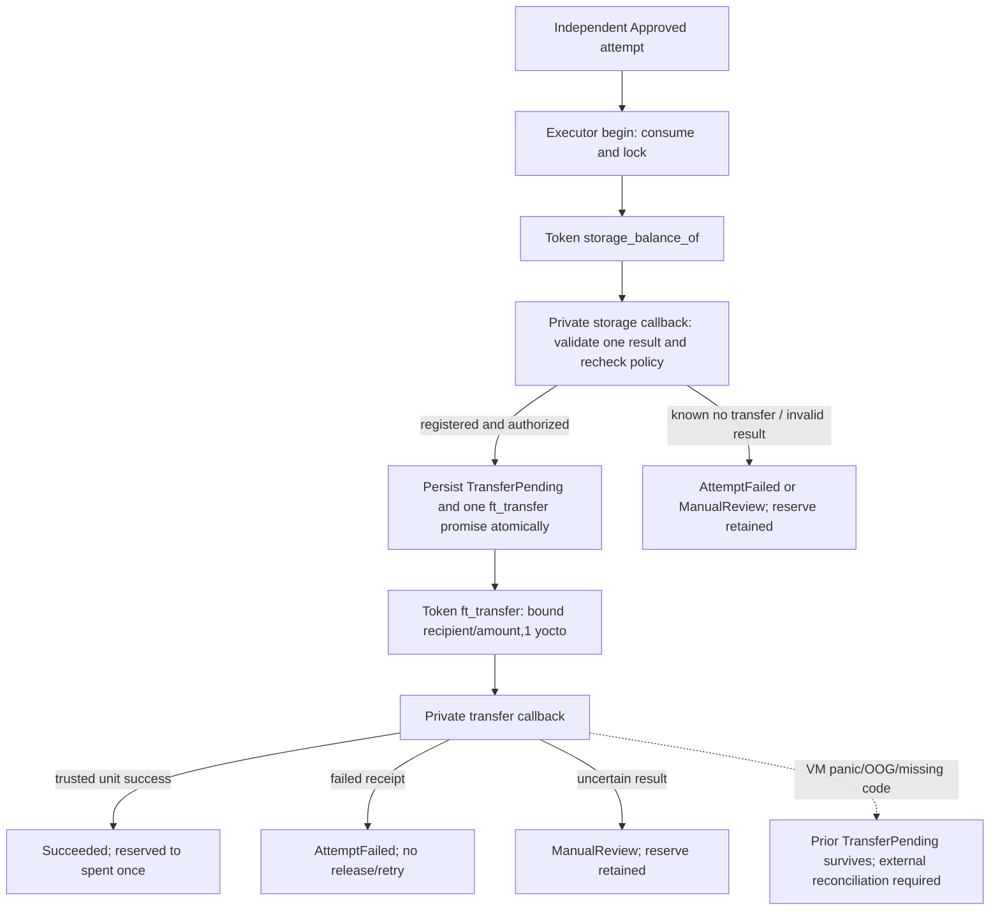

# M5-C — Native transfer implementation

**PASS for local M5-C implementation and tests. No deployment approval.**

Base revision `fdd8b48acaa1ad60417ad628b08a7783ede9aba6`; initially clean `main...origin/main`.
Implementation/validation: 2026-11-16, Africa/Douala. Local changes are uncommitted.

## Actual implementation

`src/native/execution.rs` extends `begin_native_preflight` into the full approved
promise chain. It accepts payout/authorization/attempt IDs only; token, recipient,
amount and memo derive from immutable bound state. Existing explicit Approver and
Executor separation, expiry/revocation, global authorization uniqueness, monotonic
attempts and mode-aware idempotency remain enforced. No new live roles or recipient
were selected. Actual recipient status remains **RECIPIENT_UNVERIFIED**.

There is no second public send/continuation endpoint. The storage callback schedules
the token action and private final callback in the same receipt that persists
TransferPending. It reloads all current state and rechecks Active/global pause,
allowlist, immutable recipient evidence, original approver/executor roles and
expiry before dispatch. A registration check is not a guarantee against later
token failure. No storage_deposit or automatic recipient funding is performed.

The fixed target is `usdc.tidepool-sandbox.testnet`, method `ft_transfer`, receiver
and amount from the reservation, decimal-string U128 amount, deterministic
`disburse:native:v1:<payout>:<attempt>` memo, exactly1 yoctoNEAR attached by Disburse.
No Operator intermediate custody, arbitrary call target or amount override exists.

## Transitions and legacy projection

| Native transition | Authority/result | Legacy payout / accounting |
| --- | --- | --- |
| Reserved→Approved | Existing independent Approver | Reserved; no money delta |
| Approved→PreflightPending | Explicit Executor; unused unexpired approval consumed; storage query scheduled atomically | Reserved; no money delta |
| PreflightPending→TransferPending | Private self-callback, one valid storage result, policy rechecked; FT+callback scheduled atomically | Executing; reservation retained |
| PreflightPending→AttemptFailed | Recipient unregistered, query receipt failed or dispatch policy no longer valid | Failed; reservation retained; no FT |
| PreflightPending→ManualReview | Malformed/oversized/inconsistent storage data or result count | ManualReview; reservation retained; no FT |
| TransferPending→Succeeded | Private matching callback, one successful trusted token unit result | Succeeded; reserved-minus-input and spent-plus-input once |
| TransferPending→AttemptFailed | Private matching callback observes failed token promise | Failed; reserved retained, spent unchanged |
| TransferPending→ManualReview | Unknown/oversized/nonunit return or unexpected result count | ManualReview; reserved retained, spent unchanged |
| Callback VM failure | Runtime rolls back that callback; no self-detection assumed | Previous PreflightPending/TransferPending survives |

AttemptFailed is the existing V1 enum name corresponding to the requested
DefinitiveFailure. It records a promise failure classification, not an independent
proof of non-delivery for an arbitrary token. There is no retry, reservation
release, native cancel/reset, or manual success method in C. Approval revocation
remains limited to unused Approved attempts; it cannot reset a consumed lock.

Both callbacks use `#[private]` plus explicit predecessor=current checks, require
matching current IDs/status/Consumed authorization, validate the complete binding
against campaign/payout, and validate the preallocated evidence slot/memo. Runtime
promise-result count must be1. SDK5.30.1 `promise_result_checked` bounds storage
response4096 bytes and token response64 bytes. Standard empty/null unit success is
accepted; unexpected data stays unresolved. Successful callback completion ignores
pause, expiry or role/token policy changes after dispatch; those cannot undo the
already dispatched transfer.

## Accounting and evidence

No campaign accounting category or legacy serialized field changed. Checked
`reserved+spent<=funded<=budget` and derived available preserve all requested
invariants. Each callback reloads the current campaign; no initiating snapshot is
replayed over another payout's accounting. Terminal-state checks stop a duplicate
callback from consuming another payout's reservation.

A100000 reservation against funded1000000 gives available900000/reserved100000/
spent0. Success gives available900000/reserved0/spent100000. Failure/unknown keeps
reserved100000/spent0; no refund transfer is invented. Physical custody can decrease
before callback bookkeeping; delivered-but-unresolved amounts stay reserved and
are not made spendable again. Pooled balances and unrelated movements require
receipt attribution rather than single balance-delta assertions.

The new `native-execution-outcomes-v1` map stores bounded preallocated metadata:
version/campaign/payout/auth/attempt/binding hash/memo, phase/result classification,
observed block/time, result count, captured byte length/hash. Transfer dispatch
clears the storage-query result slot before awaiting token evidence. Zero hash is
a no-captured-result sentinel, not a receipt hash. No transaction/receipt ID or
provider attestation is fabricated. `get_native_execution_outcome` exposes this
evidence; later external finalized receipt verification remains M5-D work.

Legacy public settlement still trusts Verifier attestations but cannot handle native
mode. All eight guards and the private release guard remain unchanged. Campaign
cancellation never releases native reserves; already dispatched success can finish
while the campaign is Cancelled. C tests cover TransferPending/Succeeded/AttemptFailed/
ManualReview bypasses; the original98 legacy/type regressions remain intact.

## Validation and scope

**146 Rust tests passed,0 failed,0 ignored**: prior126 foundations/regressions plus
20 new C unit tests. B tests were adapted from zero-receipt assertions to exact
storage scheduling and no-new-receipt rejection checks; two descriptive names were
updated. Formatting, warnings-denied Clippy, locked local WASM build, fixture format
and diff checks pass. Sandbox evidence covers20 scenario groups, including all10
requested scenarios, with real receipts. This is not mocked-callback-only proof.

Candidate SHA256: `37e432600c43d5fc7d44b2d81bc9a852d5e120a7dc043c7f06f83d1e62a24ea9`.
Actual tested historical→candidate artifact matches the final build byte for byte.
[Structured implementation results](evidence/milestone-5/m5c-implementation-results.json).
[Real receipt results](milestone-5c-asynchronous-test-results.md).
[Gas/storage results](milestone-5c-promise-and-gas-results.md).
[Failure safety](milestone-5c-callback-failure-safety.md).
[Migration results](milestone-5c-migration-validation-results.md).

The earlier independent review remains historical BLOCKED evidence for absent C;
it was not overwritten. This is implementation validation, not a new independent
security sign-off. No live transaction, deployment, Campaign0 change, keychain
access, role change, PostgreSQL write, worker or read-only-mode change occurred.
One public view_code query authenticated old WASM; it changed no state.

## Remaining risks / next gate

High-impact root code-upgrade authority and trusted-token semantics remain explicit
assumptions; arbitrary malicious replacement code/token behavior cannot be secured
by a private callback alone. Unknown or failed callbacks require independent
reconciliation, never automatic resend. Old B consumed orphans remain frozen.
Future M5-D recovery, M5-E deployment/migration procedures, real recipient proof,
Tidepool-specific code/gas review and service integration remain gated. Contract
storage is subsidized; resource exhaustion can still stop liveness. Preallocation,
bounds and locked failures protect against duplicate payment, not every DoS.

Next: a **separately approved independent M5-C security review**, before M5-D.
No Testnet deployment or recovery approval is requested here.
