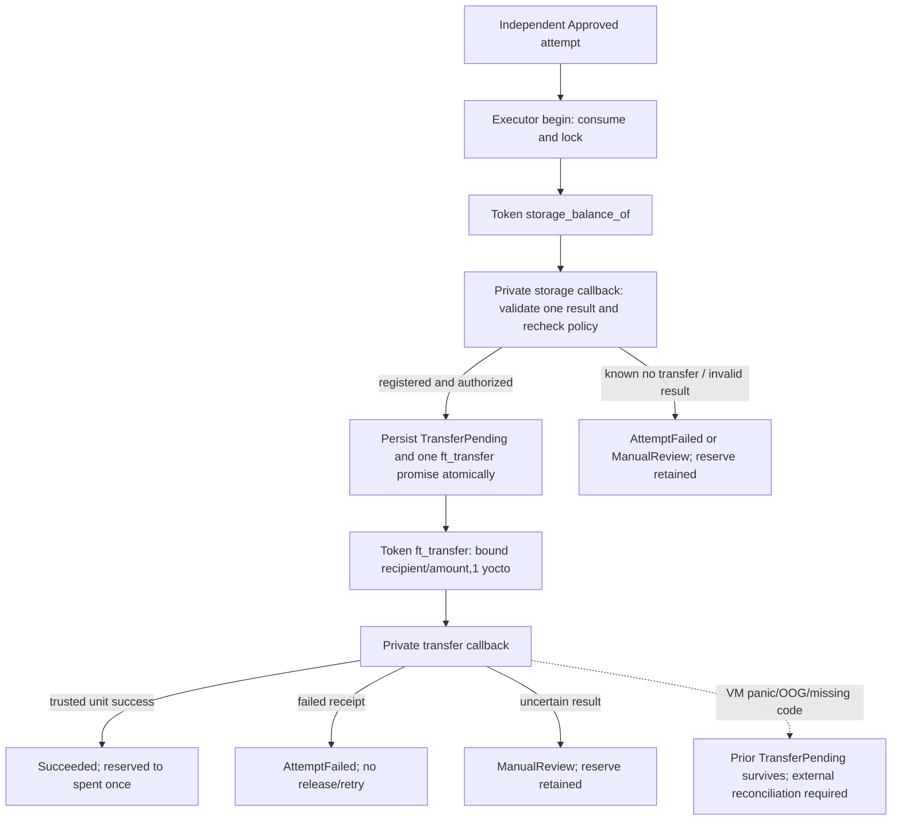

# M5-C — Native transfer implementation

**PASS for local M5-C implementation and tests. No deployment approval.**

Base revision `fdd8b48acaa1ad60417ad628b08a7783ede9aba6`; initially clean `main...origin/main`.
Implementation/validation: 2026-11-16, Africa/Douala. Work began as uncommitted local changes; see the revision note below.

## Actual implementation

`src/native/execution.rs` extends `begin_native_preflight` into the full approved
promise chain. It accepts payout/authorization/attempt IDs only; token, recipient,
amount and memo derive from immutable bound state. Existing explicit Approver and
Executor separation, expiry/revocation, global authorization uniqueness, monotonic
attempts and mode-aware idempotency remain enforced. No new live roles or recipient
were selected. Actual recipient status remains **RECIPIENT_UNVERIFIED**.

There is no second public send/continuation endpoint. The storage callback schedules
the token action and private final callback in the same receipt that persists
TransferPending. It reloads all current state and rechecks Active/global pause,
allowlist, immutable recipient evidence, original approver/executor roles and
expiry before dispatch. A registration check is not a guarantee against later
token failure. No storage_deposit or automatic recipient funding is performed.

The fixed target is `usdc.tidepool-sandbox.testnet`, method `ft_transfer`, receiver
and amount from the reservation, decimal-string U128 amount, deterministic
`disburse:native:v1:<payout>:<attempt>` memo, exactly1 yoctoNEAR attached by Disburse.
No Operator intermediate custody, arbitrary call target or amount override exists.

## Transitions and legacy projection

| Native transition | Authority/result | Legacy payout / accounting |
| --- | --- | --- |
| Reserved→Approved | Existing independent Approver | Reserved; no money delta |
| Approved→PreflightPending | Explicit Executor; unused unexpired approval consumed; storage query scheduled atomically | Reserved; no money delta |
| PreflightPending→TransferPending | Private self-callback, one valid storage result, policy rechecked; FT+callback scheduled atomically | Executing; reservation retained |
| PreflightPending→AttemptFailed | Recipient unregistered, query receipt failed or dispatch policy no longer valid | Failed; reservation retained; no FT |
| PreflightPending→ManualReview | Malformed/oversized/inconsistent storage data or result count | ManualReview; reservation retained; no FT |
| TransferPending→Succeeded | Private matching callback, one successful trusted token unit result | Succeeded; reserved-minus-input and spent-plus-input once |
| TransferPending→AttemptFailed | Private matching callback observes failed token promise | Failed; reserved retained, spent unchanged |
| TransferPending→ManualReview | Unknown/oversized/nonunit return or unexpected result count | ManualReview; reserved retained, spent unchanged |
| Callback VM failure | Runtime rolls back that callback; no self-detection assumed | Previous PreflightPending/TransferPending survives |

AttemptFailed is the existing V1 enum name corresponding to the requested
DefinitiveFailure. It records a promise failure classification, not an independent
proof of non-delivery for an arbitrary token. There is no retry, reservation
release, native cancel/reset, or manual success method in C. Approval revocation
remains limited to unused Approved attempts; it cannot reset a consumed lock.

Both callbacks use `#[private]` plus explicit predecessor=current checks, require
matching current IDs/status/Consumed authorization, validate the complete binding
against campaign/payout, and validate the preallocated evidence slot/memo. Runtime
promise-result count must be1. SDK5.30.1 `promise_result_checked` bounds storage
response4096 bytes and token response64 bytes. Standard empty/null unit success is
accepted; unexpected data stays unresolved. Successful callback completion ignores
pause, expiry or role/token policy changes after dispatch; those cannot undo the
already dispatched transfer.

## Accounting and evidence

No campaign accounting category or legacy serialized field changed. Checked
`reserved+spent<=funded<=budget` and derived available preserve all requested
invariants. Each callback reloads the current campaign; no initiating snapshot is
replayed over another payout's accounting. Terminal-state checks stop a duplicate
callback from consuming another payout's reservation.

A100000 reservation against funded1000000 gives available900000/reserved100000/
spent0. Success gives available900000/reserved0/spent100000. Failure/unknown keeps
reserved100000/spent0; no refund transfer is invented. Physical custody can decrease
before callback bookkeeping; delivered-but-unresolved amounts stay reserved and
are not made spendable again. Pooled balances and unrelated movements require
receipt attribution rather than single balance-delta assertions.

The new `native-execution-outcomes-v1` map stores bounded preallocated metadata:
version/campaign/payout/auth/attempt/binding hash/memo, phase/result classification,
observed block/time, result count, captured byte length/hash. Transfer dispatch
clears the storage-query result slot before awaiting token evidence. Zero hash is
a no-captured-result sentinel, not a receipt hash. No transaction/receipt ID or
provider attestation is fabricated. `get_native_execution_outcome` exposes this
evidence; later external finalized receipt verification remains M5-D work.

Legacy public settlement still trusts Verifier attestations but cannot handle native
mode. All eight guards and the private release guard remain unchanged. Campaign
cancellation never releases native reserves; already dispatched success can finish
while the campaign is Cancelled. C tests cover TransferPending/Succeeded/AttemptFailed/
ManualReview bypasses; the original98 legacy/type regressions remain intact.

## Validation and scope

**146 Rust tests passed,0 failed,0 ignored**: prior126 foundations/regressions plus
20 new C unit tests. B tests were adapted from zero-receipt assertions to exact
storage scheduling and no-new-receipt rejection checks; two descriptive names were
updated. Formatting, warnings-denied Clippy, locked local WASM build, fixture format
and diff checks pass. Sandbox evidence covers20 scenario groups, including all10
requested scenarios, with real receipts. This is not mocked-callback-only proof.

Candidate SHA256: `37e432600c43d5fc7d44b2d81bc9a852d5e120a7dc043c7f06f83d1e62a24ea9`.
Actual tested historical→candidate artifact matches the final build byte for byte.
[Structured implementation results](evidence/milestone-5/m5c-implementation-results.json).
[Real receipt results](milestone-5c-asynchronous-test-results.md).
[Gas/storage results](milestone-5c-promise-and-gas-results.md).
[Failure safety](milestone-5c-callback-failure-safety.md).
[Migration results](milestone-5c-migration-validation-results.md).

The earlier independent review remains historical BLOCKED evidence for absent C;
it was not overwritten. This is implementation validation, not a new independent
security sign-off. No live transaction, deployment, Campaign0 change, keychain
access, role change, PostgreSQL write, worker or read-only-mode change occurred.
One public view_code query authenticated old WASM; it changed no state.

## Remaining risks / next gate

High-impact root code-upgrade authority and trusted-token semantics remain explicit
assumptions; arbitrary malicious replacement code/token behavior cannot be secured
by a private callback alone. Unknown or failed callbacks require independent
reconciliation, never automatic resend. Old B consumed orphans remain frozen.
Future M5-D recovery, M5-E deployment/migration procedures, real recipient proof,
Tidepool-specific code/gas review and service integration remain gated. Contract
storage is subsidized; resource exhaustion can still stop liveness. Preallocation,
bounds and locked failures protect against duplicate payment, not every DoS.

Next: a **separately approved independent M5-C security review**, before M5-D.
No Testnet deployment or recovery approval is requested here.

## Repository revision note

During this session HEAD advanced externally to `d6f444ae5f6d1843206421f138908db7fca4db30`, capturing in-progress files. No commit/push commands were issued by this session; that commit was preserved. Subsequent report/evidence edits remain local.

## Complete changed-file inventory

Compared with the recorded starting revision, including files captured by the external commit. Generated target artifacts are ignored; no binary is committed by this session.

| Path | Purpose |
| --- | --- |
| `docs/evidence/milestone-5/m5c-implementation-results.json` | Structured acceptance, hashes, validation, scope, residual risks and approval gate. |
| `docs/evidence/milestone-5/m5c-implementation/all-sandbox-suites.json` | Structured provenance, runtime measurements, validation or case/tooling metadata for all-sandbox-suites. |
| `docs/evidence/milestone-5/m5c-implementation/baseline-tests.log` | Recorded local command/test/build output for baseline-tests. |
| `docs/evidence/milestone-5/m5c-implementation/baseline.json` | Structured provenance, runtime measurements, validation or case/tooling metadata for baseline. |
| `docs/evidence/milestone-5/m5c-implementation/build.log` | Recorded local command/test/build output for build. |
| `docs/evidence/milestone-5/m5c-implementation/candidate-abi.json` | Structured provenance, runtime measurements, validation or case/tooling metadata for candidate-abi. |
| `docs/evidence/milestone-5/m5c-implementation/clippy.log` | Recorded local command/test/build output for clippy. |
| `docs/evidence/milestone-5/m5c-implementation/diff-check.log` | Recorded local command/test/build output for diff-check. |
| `docs/evidence/milestone-5/m5c-implementation/fault-artifact-manifest.json` | Structured provenance, runtime measurements, validation or case/tooling metadata for fault-artifact-manifest. |
| `docs/evidence/milestone-5/m5c-implementation/fixture-fmt.log` | Recorded local command/test/build output for fixture-fmt. |
| `docs/evidence/milestone-5/m5c-implementation/fmt.log` | Recorded local command/test/build output for fmt. |
| `docs/evidence/milestone-5/m5c-implementation/gas-and-storage-measurements.json` | Structured provenance, runtime measurements, validation or case/tooling metadata for gas-and-storage-measurements. |
| `docs/evidence/milestone-5/m5c-implementation/historical-wasm-provenance.json` | Structured provenance, runtime measurements, validation or case/tooling metadata for historical-wasm-provenance. |
| `docs/evidence/milestone-5/m5c-implementation/integrity-checks.json` | Structured provenance, runtime measurements, validation or case/tooling metadata for integrity-checks. |
| `docs/evidence/milestone-5/m5c-implementation/local-protocol-config.json` | Structured provenance, runtime measurements, validation or case/tooling metadata for local-protocol-config. |
| `docs/evidence/milestone-5/m5c-implementation/missing-callback-build.log` | Recorded local command/test/build output for missing-callback-build. |
| `docs/evidence/milestone-5/m5c-implementation/node-b-migration.json` | Structured provenance, runtime measurements, validation or case/tooling metadata for node-b-migration. |
| `docs/evidence/milestone-5/m5c-implementation/node-faults.json` | Structured provenance, runtime measurements, validation or case/tooling metadata for node-faults. |
| `docs/evidence/milestone-5/m5c-implementation/node-inspect.json` | Structured provenance, runtime measurements, validation or case/tooling metadata for node-inspect. |
| `docs/evidence/milestone-5/m5c-implementation/node-main.json` | Structured provenance, runtime measurements, validation or case/tooling metadata for node-main. |
| `docs/evidence/milestone-5/m5c-implementation/old-b-build.log` | Recorded local command/test/build output for old-b-build. |
| `docs/evidence/milestone-5/m5c-implementation/oog-callback-build.log` | Recorded local command/test/build output for oog-callback-build. |
| `docs/evidence/milestone-5/m5c-implementation/panic-callback-build.log` | Recorded local command/test/build output for panic-callback-build. |
| `docs/evidence/milestone-5/m5c-implementation/runtime-inspection.log` | Recorded local command/test/build output for runtime-inspection. |
| `docs/evidence/milestone-5/m5c-implementation/sandbox-b-migration.log` | Recorded local command/test/build output for sandbox-b-migration. |
| `docs/evidence/milestone-5/m5c-implementation/sandbox-faults.log` | Recorded local command/test/build output for sandbox-faults. |
| `docs/evidence/milestone-5/m5c-implementation/sandbox-main.log` | Recorded local command/test/build output for sandbox-main. |
| `docs/evidence/milestone-5/m5c-implementation/sandbox-suite.log` | Recorded local command/test/build output for sandbox-suite. |
| `docs/evidence/milestone-5/m5c-implementation/sandbox/b-to-c-wasm-migration.json` | Public synthetic-chain receipt/transaction outcomes, pre/post balances/accounting, rejection or migration proof for b-to-c-wasm-migration. |
| `docs/evidence/milestone-5/m5c-implementation/sandbox/concurrent-duplicate-execution.json` | Public synthetic-chain receipt/transaction outcomes, pre/post balances/accounting, rejection or migration proof for concurrent-duplicate-execution. |
| `docs/evidence/milestone-5/m5c-implementation/sandbox/concurrent-payout-one.json` | Public synthetic-chain receipt/transaction outcomes, pre/post balances/accounting, rejection or migration proof for concurrent-payout-one. |
| `docs/evidence/milestone-5/m5c-implementation/sandbox/concurrent-payout-two.json` | Public synthetic-chain receipt/transaction outcomes, pre/post balances/accounting, rejection or migration proof for concurrent-payout-two. |
| `docs/evidence/milestone-5/m5c-implementation/sandbox/definitive-token-failure.json` | Public synthetic-chain receipt/transaction outcomes, pre/post balances/accounting, rejection or migration proof for definitive-token-failure. |
| `docs/evidence/milestone-5/m5c-implementation/sandbox/delivered-but-unexpected-result.json` | Public synthetic-chain receipt/transaction outcomes, pre/post balances/accounting, rejection or migration proof for delivered-but-unexpected-result. |
| `docs/evidence/milestone-5/m5c-implementation/sandbox/external-callback-payout-success.json` | Public synthetic-chain receipt/transaction outcomes, pre/post balances/accounting, rejection or migration proof for external-callback-payout-success. |
| `docs/evidence/milestone-5/m5c-implementation/sandbox/external-callbacks-rejected.json` | Public synthetic-chain receipt/transaction outcomes, pre/post balances/accounting, rejection or migration proof for external-callbacks-rejected. |
| `docs/evidence/milestone-5/m5c-implementation/sandbox/fault-suite-summary.json` | Public synthetic-chain receipt/transaction outcomes, pre/post balances/accounting, rejection or migration proof for fault-suite-summary. |
| `docs/evidence/milestone-5/m5c-implementation/sandbox/historical-wasm-migration.json` | Public synthetic-chain receipt/transaction outcomes, pre/post balances/accounting, rejection or migration proof for historical-wasm-migration. |
| `docs/evidence/milestone-5/m5c-implementation/sandbox/index.json` | Public synthetic-chain receipt/transaction outcomes, pre/post balances/accounting, rejection or migration proof for index. |
| `docs/evidence/milestone-5/m5c-implementation/sandbox/insufficient-token-balance.json` | Public synthetic-chain receipt/transaction outcomes, pre/post balances/accounting, rejection or migration proof for insufficient-token-balance. |
| `docs/evidence/milestone-5/m5c-implementation/sandbox/minimum-gas-and-low-gas-rejection.json` | Public synthetic-chain receipt/transaction outcomes, pre/post balances/accounting, rejection or migration proof for minimum-gas-and-low-gas-rejection. |
| `docs/evidence/milestone-5/m5c-implementation/sandbox/missing-recipient-storage.json` | Public synthetic-chain receipt/transaction outcomes, pre/post balances/accounting, rejection or migration proof for missing-recipient-storage. |
| `docs/evidence/milestone-5/m5c-implementation/sandbox/native-near-headroom.json` | Public synthetic-chain receipt/transaction outcomes, pre/post balances/accounting, rejection or migration proof for native-near-headroom. |
| `docs/evidence/milestone-5/m5c-implementation/sandbox/oog-callback-duplicate-rejected.json` | Public synthetic-chain receipt/transaction outcomes, pre/post balances/accounting, rejection or migration proof for oog-callback-duplicate-rejected. |
| `docs/evidence/milestone-5/m5c-implementation/sandbox/oog-callback.json` | Public synthetic-chain receipt/transaction outcomes, pre/post balances/accounting, rejection or migration proof for oog-callback. |
| `docs/evidence/milestone-5/m5c-implementation/sandbox/panic-callback-duplicate-rejected.json` | Public synthetic-chain receipt/transaction outcomes, pre/post balances/accounting, rejection or migration proof for panic-callback-duplicate-rejected. |
| `docs/evidence/milestone-5/m5c-implementation/sandbox/panic-callback.json` | Public synthetic-chain receipt/transaction outcomes, pre/post balances/accounting, rejection or migration proof for panic-callback. |
| `docs/evidence/milestone-5/m5c-implementation/sandbox/pause-after-dispatch.json` | Public synthetic-chain receipt/transaction outcomes, pre/post balances/accounting, rejection or migration proof for pause-after-dispatch. |
| `docs/evidence/milestone-5/m5c-implementation/sandbox/restart-uncertain-response-model.json` | Public synthetic-chain receipt/transaction outcomes, pre/post balances/accounting, rejection or migration proof for restart-uncertain-response-model. |
| `docs/evidence/milestone-5/m5c-implementation/sandbox/same-campaign-concurrent-payouts.json` | Public synthetic-chain receipt/transaction outcomes, pre/post balances/accounting, rejection or migration proof for same-campaign-concurrent-payouts. |
| `docs/evidence/milestone-5/m5c-implementation/sandbox/schedule-panic-duplicate-rejected.json` | Public synthetic-chain receipt/transaction outcomes, pre/post balances/accounting, rejection or migration proof for schedule-panic-duplicate-rejected. |
| `docs/evidence/milestone-5/m5c-implementation/sandbox/schedule-panic.json` | Public synthetic-chain receipt/transaction outcomes, pre/post balances/accounting, rejection or migration proof for schedule-panic. |
| `docs/evidence/milestone-5/m5c-implementation/sandbox/stale-duplicate-self-callbacks.json` | Public synthetic-chain receipt/transaction outcomes, pre/post balances/accounting, rejection or migration proof for stale-duplicate-self-callbacks. |
| `docs/evidence/milestone-5/m5c-implementation/sandbox/successful-transfer-duplicate-rejected.json` | Public synthetic-chain receipt/transaction outcomes, pre/post balances/accounting, rejection or migration proof for successful-transfer-duplicate-rejected. |
| `docs/evidence/milestone-5/m5c-implementation/sandbox/successful-transfer.json` | Public synthetic-chain receipt/transaction outcomes, pre/post balances/accounting, rejection or migration proof for successful-transfer. |
| `docs/evidence/milestone-5/m5c-implementation/sandbox/suite-summary.json` | Public synthetic-chain receipt/transaction outcomes, pre/post balances/accounting, rejection or migration proof for suite-summary. |
| `docs/evidence/milestone-5/m5c-implementation/sandbox/upgrade-between-transfer-and-callback.json` | Public synthetic-chain receipt/transaction outcomes, pre/post balances/accounting, rejection or migration proof for upgrade-between-transfer-and-callback. |
| `docs/evidence/milestone-5/m5c-implementation/scenario-matrix.json` | Structured provenance, runtime measurements, validation or case/tooling metadata for scenario-matrix. |
| `docs/evidence/milestone-5/m5c-implementation/schedule-panic-build.log` | Recorded local command/test/build output for schedule-panic-build. |
| `docs/evidence/milestone-5/m5c-implementation/token-build.log` | Recorded local command/test/build output for token-build. |
| `docs/evidence/milestone-5/m5c-implementation/tooling.json` | Structured provenance, runtime measurements, validation or case/tooling metadata for tooling. |
| `docs/evidence/milestone-5/m5c-implementation/unit-tests.log` | Recorded local command/test/build output for unit-tests. |
| `docs/evidence/milestone-5/m5c-implementation/validation.json` | Structured provenance, runtime measurements, validation or case/tooling metadata for validation. |
| `docs/milestone-5c-asynchronous-test-results.md` | Actual receipt scenario matrix, tooling and mock/injection limitations. |
| `docs/milestone-5c-callback-failure-safety.md` | Failure outcomes, lock/rollback evidence, token/root trust and recovery boundary. |
| `docs/milestone-5c-migration-validation-results.md` | Historical/raw and real old/B-WASM migration results and remaining live gates. |
| `docs/milestone-5c-native-transfer-implementation.md` | Implementation/authorization/state/accounting summary and complete file inventory. |
| `docs/milestone-5c-promise-and-gas-results.md` | Configured versus measured gas/storage and protocol limits. |
| `src/native.rs` | Reuse authorization/binding helpers; move preflight to executor module; validate legacy status projection across native phases. |
| `src/native/execution.rs` | Atomic storage/transfer promises, private bounded callbacks, exactly-once accounting, retained failure locks and native outcome view. |
| `src/native/execution_tests.rs` | 20 new adversarial unit/promise-result tests, including double settlement against another live reservation. |
| `src/native/tests.rs` | Adapt B receipt assertions/return types; retain authority/replay cases and test20 prefix namespaces. |
| `src/state/mod.rs` | Register new execution-evidence schema module. |
| `src/state/native.rs` | Document active C phases; no V1 field/discriminant changes. |
| `src/state/native_execution.rs` | New bounded versioned evidence type/outcome kinds; no legacy fields appended. |
| `tests/sandbox/.gitignore` | Ignore Python caches/local target outputs. |
| `tests/sandbox/README.md` | Pinned, loopback-only reproduction steps and explicit fixture/trust limits. |
| `tests/sandbox/build_artifacts.py` | Build production/token/variant artifacts with existing locked dependencies. |
| `tests/sandbox/build_variants.py` | Auditable isolated panic/OOG/scheduling/incompatible-callback artifacts and authenticated old-B build. |
| `tests/sandbox/collect_runtime_evidence.py` | Read-only protocol/gas/storage/block-order collection. |
| `tests/sandbox/fetch_historical_wasm.py` | Hash-authenticated public read-only old-WASM fetch; no signer. |
| `tests/sandbox/local_rpc.py` | Synthetic loopback-chain guarded signer/Borsh/RPC client; no user keychain. |
| `tests/sandbox/run_b_migration.py` | Actual old-B sidecar upgrade/approved execution/orphan-lock test. |
| `tests/sandbox/run_native_payout.py` | Actual receipt, balance, failure, concurrency and migration assertions. |
| `tests/sandbox/run_suite.py` | Sequential three-phase integration suite with nonzero failure propagation. |
| `tests/sandbox/token/Cargo.lock` | Isolated local SDK5.30.1 standard-token fixture or its manifest/unchanged-version lock graph; owner-only fault controls never deployed publicly. |
| `tests/sandbox/token/Cargo.toml` | Isolated local SDK5.30.1 standard-token fixture or its manifest/unchanged-version lock graph; owner-only fault controls never deployed publicly. |
| `tests/sandbox/token/src/lib.rs` | Isolated local SDK5.30.1 standard-token fixture or its manifest/unchanged-version lock graph; owner-only fault controls never deployed publicly. |
| `tests/sandbox/with_node.py` | Fresh synthetic genesis, loopback-only node lifecycle and cleanup. |
