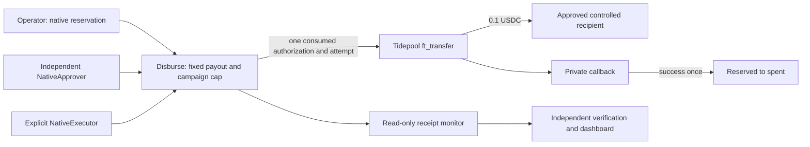
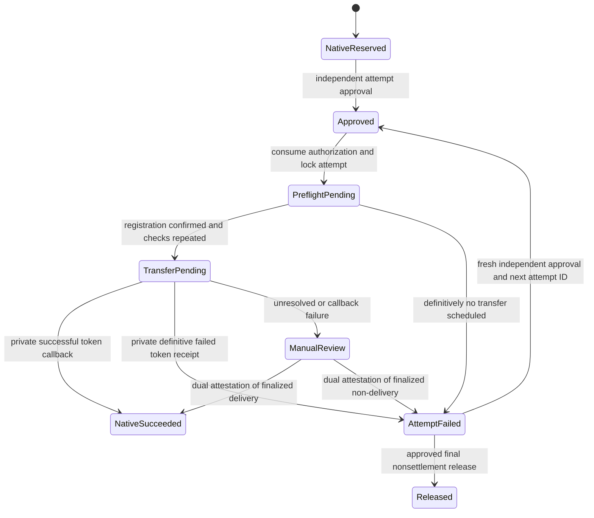

# Milestone 5-A — Native NEAR Testnet payout architecture

For current implementation findings and readiness, see the [latest security review](milestone-5d2-independent-security-review.md). Historical milestone statements below describe their original scope and do not authorize execution.

**DESIGN READY FOR REVIEW. Design only; no native execution exists yet.**
Revision `913ae89e627c287af176aa9b0e6f9e4091d68ab7`, inspected 2026-11-15 UTC.
Existing M4 working-tree changes were preserved. This document proposes future
interfaces, not an executable transaction or an authorization to deploy.

## Evidence and current deployment

[Finalized public RPC evidence](evidence/milestone-5/finalized-preflight.json)
uses one pinned finalized block: **277843166**, hash
`5ccVg6DsrNnk4VXWtKGRp8Z4QEjMvsu7HFSt7V526TNG`.
An [independent RPC](evidence/milestone-5/independent-rpc.json) corroborates
accounting and contract token balance at that same block. This avoids comparing
balances and accounting from different blocks. The snapshot
was collected at 2026-11-15T18:44:44Z. Future execution requires a fresh preflight.

| Property | Fresh observation |
| --- | --- |
| Network / contract | NEAR Testnet / `disburse-test-contract.testnet` |
| Code hash | `CJUcu5UqBYA4ZV47TJMABQJWc7MdvdaYYMNdDeB1mxcf` |
| Local WASM equality | Byte-for-byte; 299058 bytes; SHA256 `a7eaa8a4f035ac34a75271a9dda3fabc9074c47e4908c8e315a432c6472ad530` |
| Application owner / pause | `disburse-topg.testnet` / false |
| Campaign 0 | Active; Disburse Milestone 3 funding verification |
| Token / decimals / allowlist | `usdc.tidepool-sandbox.testnet` / 6 / true |
| Budget / funded / available | 1000000 / 1000000 / 1000000 atomic units |
| Reserved / spent | 0 / 0 |
| Campaign count / next payout ID | 1 / 0; next ID decoded from source-matching Borsh STATE |
| Payout 0 | null; full state contains no payout records |
| Contract / Operator token balance | 1000000 / 99000000 |
| Contract / Operator token storage | Registered; each total 1250000000000000000000 yoctoNEAR, available 0 |
| Contract NEAR / storage bytes | 9997589250750002699999999 yoctoNEAR / 299843 bytes |
| Token code hash | `DgV3WsKJsGtCjNWxYzFvi599szo7oojkKXWCoGBBAHwj` |

The source-aware STATE decoder and checks are in
[structured review](evidence/milestone-5/native-payout-design-review.json).
Code equality connects this review to the existing artifact and recorded M2 build;
it is not an independent reproducible-build attestation. The source has no native
transfer promise. See M4 activation (historical report in Git history) and
M4 routing feasibility (historical report in Git history).

## Existing implementation, not inferred capabilities

Primary source: `src/lib.rs`, `src/state/{campaign,payout}.rs`,
`src/types/{amount,destination,status,role,evidence}.rs`; generated ABI
`target/near/disburse_contract_abi.json` and prior deployed ABI evidence.

| Existing methods | Authority and actual effect |
| --- | --- |
| `ft_on_transfer(sender_id, amount: U128, msg)` | Only allowlisted predecessor token, matching Approved campaign, positive amount, budget headroom, unpaused; credits funded and returns unused amount. Active campaign funding is rejected/refunded by the token resolver. Plain `ft_transfer` credits custody without campaign allocation. |
| `create_payout(...) -> u64` | Operator or Administrator (owner implicit administrator), unpaused; new request requires Active campaign, matching input NEAR token and enough available. Increases reserved only. Internal Created→Authorized→Reserved happens in one call, not independent approval. |
| `start_payout_execution(payout_id, execution_reference)` | Operator/Admin, unpaused; Reserved→Executing, unique reference. No token action. |
| `mark_payout_pending_verification(payout_id)` | Operator/Admin, unpaused; Executing→PendingVerification, indexed reference required. No delivery proof. |
| `mark_payout_failed(payout_id, evidence)` | Operator/Admin; Executing/PendingVerification→Failed, structured attestation; submitted state cannot use RejectedBeforeSubmission. Reserved remains locked; callable while paused. |
| `move_payout_to_manual_review(payout_id, reason)` | Operator/Admin quarantine; allowed while paused, preserves reservation. |
| `settle_payout(payout_id, evidence)` | Explicit Verifier, including while paused; PendingVerification→Succeeded. Checks identity, destination, amount, evidence/reference replay indexes; subtracts input from reserved, adds to spent. **Trusts attestation; does not verify an actual token transfer.** |
| `release_failed_payout_reservation` | Explicit Verifier, Failed plus failure/nonsettlement evidence and replay controls; reserved decreases, available increases, ReservationReleased. |
| `confirm_manual_review_execution` | Explicit Verifier, ManualReview→PendingVerification after execution confirmation; no accounting move; settlement still separate. |
| `release_manual_review_reservation` | Explicit Verifier, ManualReview plus nonsettlement evidence; releases accounting. |
| Views | Campaign/funding/accounting, payout, scoped payout, idempotency lookup; no native attempt view. |
| Owner/configuration/lifecycle | Owner controls global pause and roles; Administrator/Operator lifecycle checks differ by method; token allowlist owner-controlled. No upgrade, migrate, native retry, withdrawal or rescue entry point. |

Exact existing reservation signature:

```rust
pub fn create_payout(&mut self, campaign_id: u64, idempotency_key: String,
    recipient_near_account_id: Option<AccountId>, destination: PayoutDestination,
    input_amount: TokenAmount, expected_output_amount: TokenAmount) -> u64
```

Idempotency key is `(campaign_id, key)`. Nonblank is required; identical full request
returns existing ID without another reservation or event, even after campaign
status changes, but caller/pause/basic amount guards still run. Different recipient,
destination, token, amount or decimals conflicts. Generic destination strings only
validate nonblank; they do not establish network support, recipient control or
native token equivalence. There is no automatic Failed→Reserved retry operation.

Campaign lifecycle permissions are distinct: `create_campaign` is permissionless
while unpaused; `approve_campaign` requires Administrator and Draft;
`activate_campaign` requires explicit Operator and Approved; pause/resume require
Operator/Admin and Active/Paused respectively. Cancellation allows creator/Admin
for Draft/Approved, Admin for Active/Paused, and rejects terminal campaigns.
These operations require global unpause. Existing cancellation does not transfer
tokens or release payout reservations. Native initiation must reject a cancelled
campaign, while completion of already dispatched transfers must still book once.
Existing `grant_role` is owner-only and rejects self-grants and Owner grants;
owner has implicit Owner/Administrator, not implicit Operator/Verifier.

Existing payout states, in Borsh order: Created, Authorized, Reserved, Executing,
PendingVerification, Succeeded, Failed, RefundPending, Refunded, ManualReview,
ReservationReleased. Existing events include `payout_reserved`,
`payout_execution_started`, `payout_pending_verification`, `payout_execution_failed`
and recovery/settlement events; none proves a native transfer.

## Recommended custody and authorization

Use a **hybrid**: on-chain reservation, independent approval and transfer/callback;
off-chain discovery, durable monitoring and independent receipt verification.
A contract promise calls the token with predecessor equal to Disburse, which owns
the NEP-141 balance. Tokens stay there until that call executes. Do not move custody
to Operator, an auxiliary wallet or Intents. No account FullAccess signer belongs
in the backend. No generic arbitrary-target, arbitrary-amount transfer function.



| Operation | Proposed on-chain authority |
| --- | --- |
| Reserve native payout | Existing Operator/Admin permission, new strict native wrapper |
| Approve an attempt | Explicit new sidecar NativeApprover permission; no implicit owner/Admin inheritance |
| Initiate | Explicit sidecar NativeExecutor, with unused approval; execution service has no implicit authority |
| Settle normal success | Private callback only, trusted token promise success |
| Record definite transfer failure | Private callback; no release |
| Quarantine | Authorized executor/Verifier can only freeze, never make spendable |
| Resolve callback loss / approve retry or release | Independent Verifier and NativeApprover matching attestations; neither may self-approve a reservation/execution they performed |
| Configure permissions / emergency pause | Owner governance; separate approval gate for any live role change |

Approver must differ from both recorded reservation actor and initiating executor.
Executor may be the reservation actor only with explicit grant and separate approval.
Distinct account IDs are enforceable on-chain; organizational independence and
control by different people require operational verification. No principal or
account is selected/granted in this milestone. Owner can change
roles, and account FullAccess can deploy arbitrary code or sign a direct transfer;
those remain root trust assumptions, not eliminated by separation of duties.
Fresh chain evidence confirms the isolated account still has a FullAccess key.
Application ownership does not confer or prove control of that key. Private keys
were not inspected and no signing proof was requested or performed.

## Proposed interfaces and immutable binding

Names/signatures below are design contracts for review, **not deployed ABI**.
Public amounts and large timestamps use decimal JSON strings (`U128`/`U64`);
SDK schema tests must freeze serialization before deployment.

- `create_native_payout(campaign_id: u64, idempotency_key: String, recipient_id: AccountId, amount: U128) -> u64`: nonpayable, strict wrapper over common reservation logic. Network/token/decimals/output derive from approved configuration and campaign, not caller-selected arbitrary destinations.
- `approve_native_execution(payout_id: u64, authorization_id: String, attempt_id: u64, expires_at_ns: U64)`: nonpayable independent approver, bounded expiry, stores canonical authorization binding below.
- `execute_native_payout(payout_id: u64, authorization_id: String, attempt_id: u64) -> Promise`: nonpayable executor; fixed values loaded from immutable reservation and approval. Returns promise graph, not a success assertion.
- Private `on_native_storage_checked(payout_id, attempt_id, authorization_id)` and `on_native_transfer_result(payout_id, attempt_id, authorization_id)`; result from runtime, never a public caller-supplied success flag.
- Proposed native views: mode, immutable reservation identity, current attempt and append-only attempt outcomes; native resolution proposals/confirmations with distinct identities and bounded receipt-evidence hashes. Resolution must be separately specified/tested in M5-D before any deployment.

Canonical authorization domain: `disburse/native-nep141/v1`, configured network
`near:testnet`, current contract account, schema version, campaign ID, payout ID,
reservation digest and actor, immutable recipient, token, decimals 6, amount,
authorization ID, approving account, expiry, monotonically allocated attempt ID.
Use unambiguous versioned Borsh/canonical encoding, never concatenated ambiguous
strings. One authorization belongs to one attempt and is atomically consumed
before any promise. No approval can alter the reservation. Expiry uses on-chain
block time; check at initiation and immediately before scheduling transfer.
Bound maximum TTL in reviewed configuration; numerical TTL remains a policy gate.
Completion callbacks remain valid after expiry. Revocation blocks unused attempts
only; it cannot cancel an already dispatched transfer.

Mode is immutable `NativeNearV1` or legacy/external. Capture native reservation
actor in a sidecar; legacy Payout has no actor field. Never convert an existing
payout to native implicitly. Shared idempotency index must also compare mode;
a key occupied by legacy payout cannot acquire native authority through a replay.
Strict native output is same token and atomic amount, six decimals, near:testnet,
and optional NEAR recipient equals destination address. No swap, slippage or quote.

Proposed versioned events: `native_execution_authorized`,
`native_execution_attempt_started`, `native_transfer_dispatched`,
`native_transfer_failed`, `native_payout_settled`, `native_payout_manual_review`,
`native_resolution_confirmed` and `native_reservation_released`. Bind network,
contract/schema version, campaign/payout/attempt/authorization IDs, token,
recipient, atomic amount, actor, prior/new state and reservation digest. Approval
includes expiry/approver; settlement includes actual outcome and accounting deltas;
review/resolution includes bounded reason/evidence digest and both attestors.
Only the post-token callback or verified bookkeeping resolution emits native settled;
started/dispatched are explicitly not delivery events. Preserve existing
`payout_reserved` fields and pair the native record/event atomically so discovery
can re-read mode; never infer native mode from a generic event name alone.

Every legacy lifecycle mutation above must **reject native mode** or dispatch to
native-specific rules, including failure, ManualReview, execution confirmation,
settlement and both release paths. Native callbacks cannot be bypassed by a
Verifier attesting nonexistent delivery. Guard coverage is a deployment blocker.

## Accounting and asynchronous state

No additional campaign money categories are needed. Available is derived:
`funded - reserved - spent`, using checked arithmetic.
Enforce `funded <= budget`, `spent <= funded`, `reserved <= funded - spent`,
`available + reserved + spent = funded` on every relevant mutation.
Native payout amount is positive and exactly its reserved input; initial demo cap
100000 atomic units requires explicit configured authorization, not arbitrary API input.

| Reference Campaign 0 stage | Available | Reserved | Spent |
| --- | ---: | ---: | ---: |
| Current | 1000000 | 0 | 0 |
| Future reservation | 900000 | 100000 | 0 |
| Approval / preflight / transfer pending / uncertain failure | 900000 | 100000 | 0 |
| Verified delivery and one settlement | 900000 | 0 | 100000 |
| Definitive nonsettlement plus approved release | 1000000 | 0 | 0 |

Pending amounts remain in reserved, including a delivered transfer whose callback
failed. Sidecar in-flight metadata is not an extra spendable accounting category.
On token success before callback, physical custody can temporarily be below
`sum(funded-spent)` by delivered but unbooked pending amounts. Reconciliation must
attribute those debits, not mark insolvency or free funds based on raw balance
alone. Funds are pooled across campaigns, so global custody checks include all
campaigns and pending attempts. Directly received surplus is not campaign funding.
No payout can use another campaign's available amount. Multiple callbacks reload
current campaign accounting and adjust only their own still-reserved amount;
never persist a stale campaign snapshot from initiation.



These are **new sidecar states**, not additions/reordering of existing enums.
Projection: NativeReserved/Approved/PreflightPending→Reserved;
TransferPending→Executing; NativeSucceeded→Succeeded; AttemptFailed→Failed;
ManualReview→ManualReview; Released→ReservationReleased. Native approval does
not reuse legacy transient Authorized as proof of independent consent.
No transition from NativeSucceeded or Released can dispatch again. Unknown state
must freeze; timeout never implies AttemptFailed. A late valid callback can settle
the same locked attempt even if quarantined, provided no resolution has finalized;
conflicting/duplicate outcome changes freeze with evidence, never decrement twice.

## Promise construction, costs and callback checks

Standard target ABI is
`ft_transfer({"receiver_id": AccountId, "amount": "100000", "memo": string|null})`,
exactly **1 yoctoNEAR** attached from contract custody. Use `ft_transfer`, not
`ft_transfer_call`; no receiver callback or Intents deposit is involved.
[NEP-141](https://github.com/near/NEPs/blob/master/neps/nep-0141.md)
defines the amount as a decimal string and this method's unit return.
[Token ABI observation](evidence/milestone-5/token-abi.json) records the actual interface.
ABI alone cannot establish token implementation restrictions or prove transfer
semantics. The observed token code hash and sandbox conformance/upgrade governance
review are mandatory before live execution; freezing/blacklisting/nonstandard
behavior cannot be ruled out from metadata. Restrict initial implementation to
this reviewed token identity. An on-chain token account allowlist cannot atomically
pin another account's code hash with a standard contract host API. Token upgrade
trust remains explicit even with off-chain hash monitoring.

1. Check native mode, Active campaign, unpaused, roles/separation, recipient approval,
   token identity/allowlist, amount/cap/reservation, expiry, remaining NEAR and gas.
2. Atomically consume approval, allocate immutable attempt slot, lock payout and
   store all callback identity/outcome fields before scheduling storage view.
3. Call token `storage_balance_of(recipient)` with zero deposit. Private storage
   callback validates one result and exact current attempt. Missing registration,
   malformed storage response, expiry or pause prevents transfer. Definitive
   preflight failure is no-transfer, preserving reserve. Callback panic leaves
   locked pending state; no automatic restart.
4. Immediately before transfer, recheck configuration and campaign, reserve and
   authorization binding; persist TransferPending before scheduling token promise
   and final callback in the same receipt. Do not pre-credit spent.
5. Final callback requires `#[private]` (predecessor=current contract), exactly one
   promise result, matching payout/mode/authorization/attempt and locked state.
   Do not use signer identity as callback authentication. Duplicate already-applied
   result is an accounting no-op; stale result cannot settle another attempt.
6. `PromiseResult::Successful` from the reviewed standard token transfer confirms
   that token receipt committed. The method has no returned transfer amount/bool;
   avoid fragile JSON decoding as a success heuristic. Failed result keeps reserve
   and records definitive attempt failure. Unexpected result/count/ABI behavior
   is uncertainty, never permission to resend. If a typed result decoder panics
   after delivery, follow callback-loss recovery, not failure retry.
7. On success update reserved-minus-amount and spent-plus-amount once, store terminal
   marker/outcome, emit native-settled event atomically. Pause/expiry/removal from
   allowlist after dispatch must not block this completion or safe reconciliation.

Gas is prepaid by the initiating transaction signer for the complete promise graph;
the contract supplies its 1 yoctoNEAR and storage backing. Do not double-charge gas
as an additional token debit. Current storage price is 10^19 yoctoNEAR/byte:
backing 299843 bytes needs 2998430000000000000000000 yoctoNEAR (~2.99843 NEAR).
Observed balance leaves **6999159250750002699999999 yoctoNEAR (~6.999159 NEAR)**
before new storage/deposits. This supports nominal deposits, not a certified future
gas/storage budget. Fixed-size/preallocated attempt outcome slots and bounded
strings keep callbacks small; measure worst-case writes and gas on real promises.

**Gas allocations are not verified yet.** Calibration candidate: outer 150 Tgas;
storage view 10; storage callback 100 (including descendants), transfer 30, final
callback 30; remaining for scheduling/serialization and margin. Nested allocations
must fit the parent callback's remaining prepaid gas, and checked constants/minimum
prepaid guards must be derived from measured worst-case sandbox receipts, not added
as though all sibling budgets were independent. Check current network maximum.
No exact live gas manifest is authorized until M5-C measurements establish caps
for this token and state size, including callback-failure injection. Callback
gas cannot be replenished retroactively. Recipient registration is separately
paid/approved by participant or named sponsor; never silently debit campaign USDC
or auto-register arbitrary recipients. Registration can change after preflight;
a resulting token error must be an atomic failure, tested against the trusted token.

## Failures, recovery and evidence

| Observed situation | Required behavior |
| --- | --- |
| Initiation never committed | No transfer; re-read on-chain approval/attempt before any resubmission. Same request may be submitted only if no consumed/pending attempt exists. |
| Storage check missing registration | No transfer; keep reserve; participant separately registers only after approval, new attempt needs fresh approval. |
| Submitted / RPC timeout / backend crash | Locked, monitor by attempt and receipt graph; do not authorize another transfer. |
| Final token receipt definitively failed | Standard atomic `ft_transfer` reverted token writes; USDC remains in source custody. No USDC refund transfer. Fees may be consumed; attached NEAR handling is distinct. Keep reserved pending fresh retry approval or approved release. |
| Token succeeded, callback succeeded | Terminal success once, reserved→spent. |
| Token succeeded, callback panicked/OOG/decoder failed | Tokens may already be delivered. Keep consumed attempt and reservation; ManualReview; settle bookkeeping without another transfer after dual finalized-evidence attestation. |
| Receipt/local state conflict, missing evidence, inconsistent RPC, unexpected balances | ManualReview, preserve reserve, no automatic retries/releases. |
| Delivered but settlement evidence unavailable | Freeze; recover receipt evidence or remain reserved. Absence of evidence is not proof of failure. |
| Pause between receipts | No new transfer at storage callback; dispatched transfer completion and safe review remain allowed. |
| Duplicate requests/callbacks | Same identity no new promise/accounting change; different identities rejected unless prior attempt definitively finalized failed and new approval exists. |

Retries have a new monotonic attempt ID and authorization ID, same payout recipient,
amount/token/campaign, evidence identifying the prior finalized token receipt as
failed (or proof that no transfer was scheduled). Never infer failure from a failed
callback or outer transaction. No unresolved attempts may coexist for a payout.
Release only after proven non-delivery and no in-flight attempt; released payout
is permanently nonexecutable. Failed normal `ft_transfer` needs no Intents refund
policy or new refund transaction. No generic recipient clawback is proposed.

**Recovery trust limitation:** a NEAR contract cannot ordinarily fetch arbitrary
RPC receipt outcomes on-chain. Callback-loss resolution is a two-principal trusted
attestation, not a trustless receipt proof. Require explicit Verifier plus distinct
NativeApprover to attest the same immutable digest of finalized receipt graph and
binding; neither overlaps reservation/execution actor. False non-delivery by colluding
attestors can still cause double payment. Hashes authenticate stored bytes, not
truth. Where evidence or independence is unavailable, remain frozen. A receipt
light-client proof verifier would be a separate larger architecture, not silently
assumed here. Native callback success needs no human attestation to book delivery.

Independent verification must obtain FINAL outcomes from two configured RPCs,
confirm same canonical block/receipts and traverse initiation→storage callback→
exact token `ft_transfer` action→final callback. Check actual executor, predecessor,
method, deposit, immutable arguments and memo `disburse:native:v1:<payout>:<attempt>`,
not logs or transaction hash alone. Check committed `nep141` transfer log with source,
recipient and amount where the reviewed token provides it. Failed-receipt logs do
not prove committed movement. Link campaign/payout/auth/attempt via stored binding,
event and promise graph; contracts do not automatically know transaction/receipt
hashes, so monitoring stores canonical receipt IDs rather than inventing host APIs.
Re-read terminal native record, legacy projection and campaign accounting. Snapshot
source and recipient balances before/after at common finalized blocks; attribute
other movements and pooled-campaign pending debits. Balance delta alone is not
payout attribution. Missing/contradictory authoritative evidence blocks closure.

## Recipient gate

**RECIPIENT_UNVERIFIED.** No account is selected and no wallet is created.
Required record: account ID, `near:testnet`, token above, participant identity,
explicit demo approval, finalized current account existence/public access-key list,
NEP-413 proof, registration, initial atomic balance and evidence block/hash.
SDK `AccountId` syntax validation does not establish account existence, network or
control. Reject recipient equal to contract, owner or Operator; require explicit
on-chain recipient allowlist approval backed by public evidence digest.

NEP-413 is suitable for off-chain proof: fresh random nonce, domain/recipient binding,
message including Testnet/contract/token/purpose, issued/expiry times and participant
account; verify its serialized tagged payload/signature independently and match
public key to that account's finalized access-key list. FullAccess proof is simplest
for this controlled demo; a function-call key alone is not unrestricted account
control. Proof does not authorize a blockchain transfer. Never request private keys.
Recheck key membership, registration and balance before each live gate. Recipient
cannot change after native reservation/approval; cancel an unexecuted reservation
under safe release rules and create a new approved payout instead.
[NEP-413 specification](https://github.com/near/NEPs/blob/master/neps/nep-0413.md).

## Execution service and dashboard

Actual service boundaries: `discovery/{events,processor,reconciler}.ts`,
`coordinator/near-discovery.ts`, `persistence/postgres-*.ts`,
`providers/{signing,refund,networks}.ts`, `providers/near-intents/*`,
`near/clients.ts`, `api/http.ts`, `host/server.ts`.
Discovery validates contract/network event identity, re-reads scoped payout snapshots,
and persists observations/jobs/cursors atomically. Reconciliation also writes DB;
neither was invoked here. Job key includes network/contract/payout, while campaign
scope is in the snapshot. Durable leases and conditional authorization consumption
protect DB concurrency, not chain replay; on-chain attempt locks remain mandatory.

Existing signing/refund records bind reservation, attempt, recipient, tokens, caps,
quote/policy hashes, expiry and single-use lifecycle. They are useful audit structures,
not on-chain spending authorization or independently authenticated human consent.
Reuse repositories only with explicit native provider/mode/version and canonical
on-chain approval snapshots; do not fabricate quotes or Intents refund policies.
Add native no-external-refund semantics explicitly. DeterministicMockSigner is not
a production signer. 1Click adapter is dry quote only and its configured production
route does not solve this Testnet custody problem; no Intents deposit is designed.

Future separate execution-enabled composition can relay only approved native calls
using a restricted, scoped signer after review. Monitoring/leases must resume an
existing attempt after crash, never resubmit a token transfer. Snapshot on-chain
approval, consume DB record with fenced job write, submit bound method; if DB/chain
commit order diverges, reconcile chain first. Chain authority wins over DB state.
Record full finalized receipt evidence and ManualReview discrepancies; no automatic
settlement from provider success, backend response or a job status.

Keep current restricted host composition unchanged: read capabilities only, no
signer/workers/migration application. Add future native views to authenticated GET
API and dashboard without enabling execution. Known numeric payout detail can read
chain directly; campaign payout list currently depends on persisted execution jobs.
A native reservation is not guaranteed to appear in that list until a separately
authorized discovery integration writes observations, or a future read-only chain
listing integration exists. Display reservation/approval/pending/delivery/settlement
separately and show evidence provenance, including DB lag. Do not display Reserved
as paid. No architecture/source changes are made in M5-A.

See [migration safety](native-payout-migration-safety.md),
[threat model](native-payout-threat-model.md) and
implementation/test plan (historical report in Git history).
